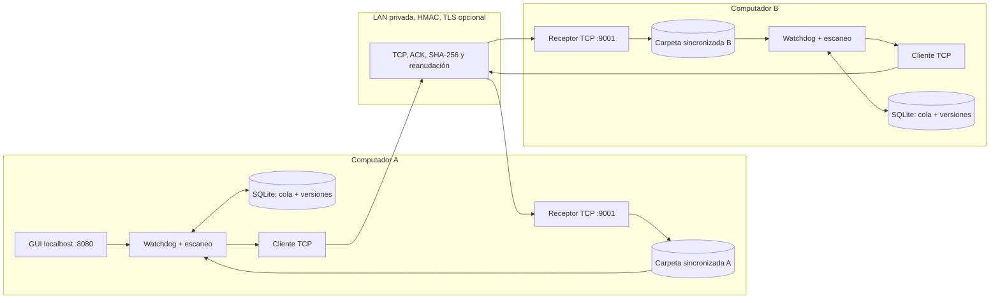

# LocalSync LAN Engine

**Sincronización automática y transferencia segura de archivos entre computadores de una red local.** Proyecto académico de **Sistemas Operativos** · Ingeniería de Software · Universidad Manuela Beltrán · **Grupo G1**.

**Integrantes:** Valery Michell Herrera Roca y Daniel Felipe Rojas Gonzales.  
**Versión interna de la API:** `0.4.0-sync` · **Rama principal:** `main` · **Actualizado:** 18 de noviembre de 2026. La versión interna **no es un release etiquetado de GitHub**.

[](https://github.com/Codeforgeettttt/localsync-lan-engine_SistemasOperativos_G1/actions/workflows/tests.yml)
[](https://github.com/Codeforgeettttt/localsync-lan-engine_SistemasOperativos_G1/actions/workflows/pruebas.yml)

> **Despliegue:** si lo único que necesitas es instalarlo, abre la [guía final paso a paso para Windows y Ubuntu](documentacion/DESPLIEGUE_FINAL.md). **No se necesita Docker ni internet para intercambiar archivos en una LAN real.**

## Qué puede hacer

| Capacidad | Estado | Funcionamiento |
| --- | --- | --- |
| Transferencia TCP manual de archivos y carpetas | ✅ | IP/puerto configurables, confirmación ACK, integridad SHA-256 |
| Sincronización automática | ✅ | Watchdog con escaneo periódico; observa una carpeta y replica cambios |
| Replicación en ambos sentidos (A ↔ B) | ✅ | Dos instancias observan sus carpetas y reciben directamente en ellas |
| Trabajos pendientes al perder la red | ✅ | **Cola SQLite persistente**, reintentos con espera progresiva |
| Reanudación de transferencias | ✅ | Temporales persistentes, negociación de byte inicial y SHA-256 final |
| Descubrimiento de equipos en LAN | ✅ | UDP 9002 + autenticación HMAC; selección manual de los equipos |
| Historial de versiones locales | ✅ | Respaldos SHA-256, índices SQLite y restauración desde GUI |
| Borrados remotos | ✅ Opt-in | Requieren token y autorización de ambos extremos; papelera recuperable |
| Conflictos manuales | ✅ | `keep-both`, `reject` o `overwrite` según configuración |
| Control de integridad | ✅ | SHA-256 antes de enviar y después de recibir |
| Autenticación de nodos | ✅ | Reto HMAC-SHA256; no transmite el secreto |
| Cifrado del tráfico | ✅ Opcional | TLS cuando se configuran certificados; sin TLS los bytes no están cifrados |
| Interfaz web local | ✅ | Resumen, Transferencias, Sincronización, Laboratorio virtual, Actividad |
| Pruebas virtuales y físicas | ✅ | Python, Chrome, Docker de dos nodos; el equipo reportó prueba LAN real |
| Despliegue persistente en Ubuntu | ✅ Plantilla | Unidad `systemd` y arranque automático configurable |

### Límites actuales

**No** existe un motor de consenso para resolver ediciones exactamente simultáneas entre varios autores. En la carpeta compartida prevalece la versión aplicada más recientemente y se guarda el contenido anterior como respaldo; es posible recuperar versiones desde la interfaz. Los parciales abandonados requieren mantenimiento de disco; no hay una política automática de retención ni recolección. El panel HTTP se diseñó **solo para el equipo local**, nunca para exponerse a Internet.

## Arquitectura general



**Puerto 8080:** panel local, no se abre a la LAN. **Puerto TCP 9001:** transporte entre equipos autorizados. **UDP 9002:** búsqueda opcional de receptores. La autenticación HMAC protege el acceso pero **no cifra**; se recomienda TLS con certificados para información sensible.

Los receptores mantienen un directorio autorizado, validan rutas y nombres, aplican SHA-256 y confirman con `ACK`. Los cambios entrantes en modo compartido actualizan los metadatos locales y no se reenvían inmediatamente al origen, evitando ciclos simples. El motor almacena temporalmente los trabajos pendientes si el receptor está desconectado.

## Inicio rápido

### Windows

1. Instala Python 3.10+ y descarga o clona el proyecto.
2. Abre PowerShell en la carpeta y ejecuta:

```powershell
git switch main
git pull origin main
.\iniciar_localsync.bat
```

3. Abre `http://127.0.0.1:8080/` si no se abre automáticamente.

### Ubuntu

```bash
git switch main
git pull origin main
sudo apt install -y python3-venv python3-pip
bash iniciar_localsync.sh
```

### Activar sincronización entre dos PCs

1. Conecta los computadores a la misma **LAN privada**.
2. Genera un **token compartido** de 16 caracteres o más en **Transferencias** y distribúyelo por canal privado.
3. En **ambos** equipos, inicia un receptor TCP en **modo LAN** y marca **Recibir directamente en carpeta sincronizada**.
4. En **Sincronización** agrega la IPv4 **del otro equipo**, puerto `9001` y el mismo token; pulsa **Autorizar equipo** e **Iniciar sincronización**.
5. Crea un archivo dentro de `carpeta_sincronizada/` en A. Aparecerá automáticamente en B. Haz una modificación en B y comprueba que se refleja en A.
6. Verifica **SHA-256**, **cola persistente** y **Versiones recuperables**. Si la red falla, se conserva el trabajo y se reintenta.

**No habilites el borrado remoto salvo que ambos hayan acordado hacerlo.** Debe estar marcado tanto en el receptor como en el motor sincronizador; la eliminación mueve el contenido a una papelera recuperable en el receptor.

La búsqueda en **Transferencias → Buscar equipos** requiere el token y UDP 9002 permitido. Si no aparecen dispositivos, puedes introducir la IPv4 manualmente.

### Envío manual (sin sincronización automática)

En **Transferencias**, prepara archivos o una carpeta, indica IP/puerto/token, comprueba conexión y pulsa **Enviar**. La casilla **Reanudar envíos interrumpidos** permite continuar archivos parciales del mismo hash tras una caída del socket. El receptor por defecto guarda en `archivos_recibidos/`, distinto de la carpeta de réplica.

## Funciones del sistema

### Watchdog y cola SQLite

- `src/backend/sync/engine.py` inspecciona cambios, utiliza eventos Watchdog cuando están disponibles y realiza escaneos de respaldo.
- Nuevos contenidos o modificaciones se agregan a `sync_queue` por cada par autorizado.
- Cuando no hay conexión, el trabajo permanece en la base local con error e intentos; la política de reintentos usa retroceso exponencial acotado.
- La contraseña/token escrito en la GUI **no se persiste**, solo los datos del equipo y la cola. Tras reiniciar, vuelve a autorizar el par o configura el arranque automático con variables protegidas.
- Las versiones se guardan por hash en `datos_locales/versiones`. Los datos operativos y archivos sincronizados están excluidos de Git.

### Protocolo TCP y seguridad

- Trama JSON `LOCALSYNC_P2P_V1`, longitud de 4 bytes big-endian y bloques binarios de 64 KiB.
- Operaciones `PING`, `CREATE`, `CREATE_RESUME`, `DELETE` (esta última solo por opt-in) y `ACK`/`ERROR`.
- Autenticación HMAC-SHA256 mediante desafío/respuesta; TLS opcional con certificado/CA.
- Reanudación: el receptor informa `offset` de su temporal y recibe únicamente los bytes restantes. Al terminar verifica SHA-256 y publica de forma atómica.
- El envío manual admite políticas de conflicto y copias `.conflict-<sha>`; en la carpeta de sincronización se utiliza sobrescritura **con respaldo previo**.
- Los borrados remotos autenticados archivan el archivo en `.localsync_deleted` en lugar de destruirlo definitivamente.

### Archivos y directorios principales

```text
LocalSync/
├── iniciar_localsync.bat / iniciar_localsync.sh
├── src/
│   ├── backend/api/
│   │   ├── routes.py                 # FastAPI y despliegue opcional
│   │   ├── lan_routes.py             # Transferencia, recepción y descubrimiento
│   │   └── sync_routes.py            # Pares, cola, estados y restauración
│   ├── backend/network/
│   │   ├── cliente_tcp.py            # Envío y CREATE_RESUME
│   │   ├── p2p_socket.py             # Receptor, HMAC, TLS, ACK, DELETE
│   │   ├── transferencia.py          # Publicación, parcial y conflictos
│   │   └── discovery.py              # Buscar equipos mediante UDP/HMAC
│   ├── backend/sync/
│   │   ├── engine.py                 # Watchdog, SQLite y versiones
│   │   └── worker.py                 # Motor autónomo para despliegue
│   ├── backend/storage/             # Metadatos de fase inicial
│   └── frontend/                    # HTML, CSS y JavaScript
├── simulacion/
│   ├── demo_local.py                 # Dos sockets localhost
│   ├── demo.py                       # Dos contenedores TCP manuales
│   ├── demo_autosync.py              # Dos Linux con réplica bidireccional
│   └── compose*.yaml
├── pruebas/                          # Pruebas unitarias y E2E
├── recursos/systemd/
│   └── localsync-autosync.service    # Servicio Linux con arranque automático
├── documentacion/                    # Manuales y diagramas
├── carpeta_sincronizada/             # Datos de usuario ignorados por Git
└── datos_locales/                    # Cola, respaldos y versiones ignoradas
```

## Probar antes de desplegar

```bash
python -m pytest -v
python simulacion/demo_local.py
# Requieren Docker Desktop/Engine:
python simulacion/demo.py --cleanup-after
python simulacion/demo_autosync.py --cleanup-after
```

**Las simulaciones Docker son de dos contenedores aislados, no dos máquinas virtuales con kernel independiente.** Se ejecutan pruebas en [GitHub Actions](https://github.com/Codeforgeettttt/localsync-lan-engine_SistemasOperativos_G1/actions) para Windows/Ubuntu, navegador Chrome, transferencia TCP y sincronización real entre contenedores.

## Documentación

| Recurso | Descripción |
| --- | --- |
| [DESPLIEGUE_FINAL.md](documentacion/DESPLIEGUE_FINAL.md) | **Instalación final paso a paso** en Windows y Ubuntu con `systemd`, TLS, firewall y comprobaciones |
| [ARQUITECTURA.md](documentacion/ARQUITECTURA.md) | Arquitectura, diagramas y decisiones de diseño |
| [PROTOCOLO_TCP.md](documentacion/PROTOCOLO_TCP.md) | Tramas, autenticación, integridad y control de errores |
| [API_Y_DATOS.md](documentacion/API_Y_DATOS.md) | Endpoints REST, SQLite y contratos |
| [MANUAL_USUARIO.md](documentacion/MANUAL_USUARIO.md) | Operación desde la GUI, archivos y laboratorio |
| [SEGURIDAD_Y_ERRORES.md](documentacion/SEGURIDAD_Y_ERRORES.md) | Modelo de amenazas y diagnóstico |
| [PRUEBAS_Y_VALIDACION.md](documentacion/PRUEBAS_Y_VALIDACION.md) | Casos, evidencias y auditorías |
| [REQUISITOS_Y_TRAZABILIDAD.md](documentacion/REQUISITOS_Y_TRAZABILIDAD.md) | Requisitos funcionales y no funcionales |
| [CONTROL_DE_VERSIONES.md](documentacion/CONTROL_DE_VERSIONES.md) | Ramas, commits, releases y control de cambios |
| [CHANGELOG.md](CHANGELOG.md) | Evolución técnica del proyecto |
| [Diagramas Mermaid](documentacion/diagramas/) | Fuentes editables y diagramas |

**Historial:** el [PR #1](https://github.com/Codeforgeettttt/localsync-lan-engine_SistemasOperativos_G1/pull/1) integró la fase de transferencia manual en `main`. Las capacidades automáticas de esta revisión se implementaron posteriormente mediante commits en `main`. Los documentos de fases anteriores permanecen como referencia histórica y pueden describir el estado previo.

**Seguridad:** emplear únicamente redes privadas de confianza, restringir el firewall por IP, proteger tokens y respaldos y activar TLS cuando el contenido sea sensible.
