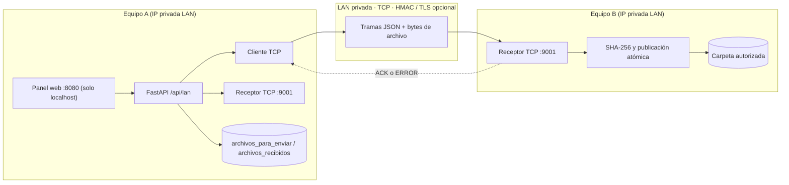

# LocalSync LAN Engine

**Transferencia directa y verificable de archivos en una red local (LAN)**  
Proyecto académico de **Sistemas Operativos · Ingeniería de Software · Universidad Manuela Beltrán · Grupo G1**.

**Integrantes:** Valery Michell Herrera Roca y Daniel Felipe Rojas Gonzales.  
**Estado documentado:** 18 de noviembre de 2026 · **rama principal:** `main` · **versión declarada por FastAPI:** `0.3.0-lan` (*versión interna; no implica que exista un release etiquetado*).

[](https://github.com/Codeforgeettttt/localsync-lan-engine_SistemasOperativos_G1/actions/workflows/pruebas.yml)
[](https://github.com/Codeforgeettttt/localsync-lan-engine_SistemasOperativos_G1/actions/workflows/tests.yml)

> **Alcance real:** LocalSync es hoy una aplicación de **transferencia manual de archivos y carpetas**, mediante TCP, entre dos nodos que pueden emitir y recibir. **No es todavía un sincronizador automático de cambios en tiempo real.** No se requiere internet ni nube para transmitir archivos; GitHub y la descarga inicial de dependencias son tareas distintas de desarrollo/instalación.

## Contenido

1. [Qué hace y qué no hace](#qué-hace-y-qué-no-hace)
2. [Arquitectura](#arquitectura)
3. [Tecnologías y requisitos](#tecnologías-y-requisitos)
4. [Instalación y primer uso](#instalación-y-primer-uso)
5. [Transferencia entre dos computadores](#transferencia-entre-dos-computadores)
6. [Pruebas virtuales y físicas](#pruebas-virtuales-y-físicas)
7. [Comandos para desarrolladores](#comandos-para-desarrolladores)
8. [Seguridad y manejo de errores](#seguridad-y-manejo-de-errores)
9. [API, datos y límites](#api-datos-y-límites)
10. [Control de versiones](#control-de-versiones)
11. [Documentación técnica](#documentación-técnica)

## Qué hace y qué no hace

| Función | Estado | Implementación |
| --- | --- | --- |
| Enviar un archivo a una IPv4 privada y puerto TCP | **Implementada** | `cliente_tcp.py` + `p2p_socket.py` |
| Transferir una carpeta con subdirectorios | **Implementada** | `enviar_carpeta` |
| Recibir y descargar archivos desde el panel | **Implementada** | API LAN + directorio local |
| Verificar contenido con SHA-256 | **Implementada** | Cálculo antes de enviar y tras recibir |
| PING/ACK y confirmación de recepción | **Implementada** | Protocolo `LOCALSYNC_P2P_V1` |
| Autenticar nodos con un secreto compartido | **Implementada** | Desafío HMAC-SHA256 |
| TLS para cifrar el canal | **Opcional** | Requiere certificados y configuración explícita |
| Reintentar una transferencia fallida | **Implementada** | Reenvía el archivo completo |
| Evitar sobrescritura silenciosa | **Implementada** | `keep-both` por defecto; `reject` / `overwrite` opcionales |
| Renombrar, borrar y verificar archivos de la bandeja local | **Implementada** | GUI y API; **no borra archivos remotos** |
| Mostrar historial reciente de operaciones | **Implementada** | Memoria de proceso (últimos eventos; no persistencia) |
| Simular dos nodos TCP sin Docker | **Implementada y probada** | `simulacion/demo_local.py` |
| Simular dos contenedores Linux en una LAN Docker | **Implementada y probada en CI** | `simulacion/demo.py` |
| Servicio receptor mediante `systemd` | **Plantilla disponible** | Requiere instalarlo y verificarlo en Ubuntu |
| Detección de cambios mediante Watchdog/inotify | **Pendiente** | Dependencia instalada, observador no operativo |
| Sincronización automática de creación/modificación/borrado | **Pendiente** | No propaga eventos `MODIFY`/`DELETE` |
| Cola persistente de reintentos y reconciliación | **Pendiente** | Esquema SQLite preparado, no conectado al transporte |
| Reanudación de transferencias por fragmento | **Pendiente** | Reintento = envío completo |

**Importante:** se puede transferir A → B y B → A **iniciando una transferencia manual en cada sentido**; esto no significa replicación bidireccional automática.

## Arquitectura



El panel web funciona en `http://127.0.0.1:8080/`. **Nunca debe exponerse el panel HTTP a toda la LAN**: es el receptor **TCP** el que escucha en la red privada cuando seleccionas *modo LAN*.

- **Frontend:** `src/frontend/index.html`, `css/styles.css`, `js/app.js`.
- **API local:** `src/backend/api/routes.py`, `lan_routes.py` y ruta de compatibilidad `p2p_routes.py`.
- **Red TCP:** `src/backend/network/cliente_tcp.py`, `p2p_socket.py`.
- **Recepción segura:** `src/backend/network/transferencia.py`.
- **Integridad y motor base:** `src/backend/core/engine.py`.
- **SQLite:** `src/backend/storage/db_manager.py` y `src/bd/schema.sql`; su esquema **no** implica sincronización persistente implementada.

Diagramas más detallados: [Arquitectura y flujos](documentacion/ARQUITECTURA.md) y [fuentes Mermaid editables](documentacion/diagramas/fuentes_mermaid/).

## Tecnologías y requisitos

| Componente | Tecnología |
| --- | --- |
| Motor TCP | Python 3.10+, `socket`, `threading`, `ssl`, `hashlib` y `hmac` |
| API web | FastAPI y Uvicorn |
| GUI | HTML, CSS y JavaScript (sin CDN para la interfaz) |
| Metadatos | SQLite 3, esquema y funciones básicas |
| Pruebas | `pytest`, `unittest`, Chrome/Playwright y GitHub Actions |
| Entorno virtual | Docker Compose (opcional) |
| Servicio Ubuntu | `systemd` (plantilla de despliegue) |

**Puerto del panel:** `8080` (loopback). **Puerto del receptor TCP:** `9001` por defecto, configurable entre `1024` y `65535`. **Tamaño máximo:** `100 MiB por archivo`. **Bloques:** `64 KiB`. La GUI limita y valida entradas; el receptor verifica rutas y contenido.

## Instalación y primer uso

Clona el repositorio o abre la copia ya descargada, y actualiza `main`:

```bash
git switch main
git pull origin main
```

### Windows (PowerShell)

Requisitos: Python 3.10+ con el lanzador `py` instalado.

```powershell
.\iniciar_localsync.bat
```

El iniciador crea `.venv`, instala `requirements.txt` en el primer inicio, ejecuta FastAPI y abre el navegador cuando `http://127.0.0.1:8080/` ya responde. **Docker Desktop no es obligatorio** para transferir archivos, solo para el laboratorio Docker.

### Ubuntu

Requisitos: `python3`, `python3-venv` y `python3-pip`.

```bash
sudo apt install -y python3-venv python3-pip
bash iniciar_localsync.sh
```

El panel también puede arrancarse manualmente:

```bash
python3 -m venv .venv
source .venv/bin/activate
python -m pip install -r requirements.txt
python -m uvicorn src.backend.api.routes:app --host 127.0.0.1 --port 8080
```

**API interactiva (Swagger):** `http://127.0.0.1:8080/docs`.

### Uso desde la GUI

1. En **Transferencias**, el equipo receptor selecciona **Red local (0.0.0.0)**, puerto `9001` y un **token compartido de al menos 16 caracteres** (mejor un secreto aleatorio largo).
2. Pulsa **Iniciar receptor**. Averigua la dirección IPv4 privada del receptor (por ejemplo, `192.168.1.25`; sustituye la cifra de ejemplo).
3. En el otro equipo, abre su panel local, escribe esa IP, el mismo puerto y el mismo token; pulsa **Comprobar conexión**.
4. Selecciona **Archivos** o **Carpeta**, espera a que aparezcan en la bandeja y pulsa **Enviar** o **Enviar todos los archivos**.
5. En el receptor, verifica el archivo en **Recibidos** y comprueba su SHA-256. Para enviar en dirección contraria, invierte los roles.

**Dos equipos:** misma red privada; firewall TCP `9001` permitido **solo para la IP autorizada**. Evita Wi-Fi público y redes con aislamiento de clientes. HMAC **autentica, pero no cifra** los archivos: configura TLS si necesitas confidencialidad.

Instrucciones detalladas, también para CLI: [Guía LAN y evidencias](pruebas/GUIA_PRUEBA_LAN.md) y [manual de operación](documentacion/MANUAL_USUARIO.md).

## Transferencia entre dos computadores

Se ha reportado funcionamiento en dos equipos físicos del proyecto. **Esa confirmación no sustituye anexar capturas fechadas ni hashes de esa sesión**.

### Terminales sin GUI (Ubuntu)

En el receptor, después de establecer `LOCALSYNC_AUTH_TOKEN` de manera privada:

```bash
python3 -m src.backend.network.p2p_socket --host 0.0.0.0 --port 9001 --directory archivos_recibidos
```

En el emisor, con el **mismo** secreto:

```bash
python3 -m src.backend.network.cliente_tcp --host 192.168.1.25 --port 9001
python3 -m src.backend.network.cliente_tcp --host 192.168.1.25 --port 9001 --file ejemplo.txt --retries 2
python3 -m src.backend.network.cliente_tcp --host 192.168.1.25 --port 9001 --directory carpeta_ejemplo --remote-prefix entregas
```

Las rutas e IP son ejemplos, no resultados reales. Comparar hashes con `sha256sum` (Ubuntu) o `Get-FileHash -Algorithm SHA256` (PowerShell).

## Pruebas virtuales y físicas

### Sin Docker (dos sockets locales)

```bash
python simulacion/demo_local.py
```

Valida dos servidores TCP diferentes en `localhost`, A → B, B → A, carpeta, integridad y conflicto. **No son dos computadores físicos ni dos contenedores separados.**

### Con Docker (dos contenedores Linux)

```bash
python simulacion/demo.py
python simulacion/demo.py --status
python simulacion/demo.py --cleanup
```

Docker crea una red interna, dos volúmenes separados y nodos `nodo-a` / `nodo-b`. Verifica ambas transferencias y versiones. `--cleanup` **borra los volúmenes de prueba** del laboratorio.

También se puede ejecutar desde **Laboratorio virtual** en la GUI, descargando un registro de evidencia.

### Pruebas automáticas

```bash
python -m pytest -v
python -m unittest discover -s pruebas -p "test_*.py" -v
```

En CI se ejecutan:

- `.github/workflows/tests.yml`: matriz Windows y Ubuntu.
- `.github/workflows/pruebas.yml`: pytest, sintaxis JS, simulación Docker, API del laboratorio y navegador Chrome; las pruebas Docker/navegador se habilitan en su propio job.

Los resultados históricos están en [Actions](https://github.com/Codeforgeettttt/localsync-lan-engine_SistemasOperativos_G1/actions). Los resultados de CI **no prueban por sí solos el firewall o la LAN del laboratorio físico**.

Consulta el [plan de pruebas, criterios y evidencias](documentacion/PRUEBAS_Y_VALIDACION.md).

## Comandos para desarrolladores

```bash
git status
git log --oneline --graph --all --max-count=20
python -m pytest -v pruebas/test_panel_lan.py
python -m pytest -v pruebas/test_lan_completo.py
```

Árbol funcional abreviado:

```text
LocalSync/
├── README.md                          # Portada y guía del proyecto
├── iniciar_localsync.bat / .sh        # Inicio Windows / Ubuntu
├── requirements.txt
├── config/                            # Configuración local
├── src/
│   ├── backend/api/                   # FastAPI, LAN y compatibilidad P2P
│   ├── backend/network/               # Cliente, servidor TCP y receptor seguro
│   ├── backend/core/                  # SHA-256, validador y estado base
│   ├── backend/storage/               # Acceso a SQLite
│   ├── bd/schema.sql                  # Modelo relacional
│   └── frontend/                      # Panel HTML/CSS/JS
├── simulacion/                        # Docker, prueba local y manual
├── pruebas/                           # Unitarias, integración, navegador y Docker
├── recursos/systemd/                  # Plantilla e instalación del servicio
├── documentacion/                     # Documentos técnicos y fuentes Mermaid
└── .github/workflows/                 # Integración continua
```

## Seguridad y manejo de errores

- **Autenticación:** HMAC-SHA256 con reto aleatorio y token compartido. El secreto no debe incluirse en el repositorio.
- **Confidencialidad:** TLS disponible **solo si se configura**. Sin TLS los bytes transferidos no están cifrados.
- **Protección de rutas:** se rechazan rutas absolutas, segmentos `..` y enlaces simbólicos relevantes.
- **Integridad:** primero se recibe a un archivo temporal, después se verifica SHA-256 y finalmente se publica mediante reemplazo atómico.
- **Conflictos:** `keep-both` conserva el original; `reject` rechaza; `overwrite` reemplaza por decisión explícita.
- **Fallos de red:** timeouts, conexión rechazada, autenticación fallida, ACK inválido y reintentos. Los reintentos **no** son reanudación por bytes.
- **Panel administrativo:** HTTP limitado a `localhost`; no publicarlo en `0.0.0.0`.

**Advertencia:** no enviar el puerto TCP a Internet, no usar el modo sin autenticación fuera de un laboratorio aislado, no subir `.env`, certificados privados ni tokens. Más casos y soluciones: [Seguridad, errores y límites](documentacion/SEGURIDAD_Y_ERRORES.md).

## API, datos y límites

La API moderna está bajo `/api/lan`. Endpoints representativos: `GET /estado`, `GET/POST /archivos`, `GET /descargar`, `POST /conexion`, `POST /enviar`, `POST /enviar-carpeta`, `POST /receptor/iniciar`, `POST /receptor/detener`, `GET /simulacion/estado` y `POST /simulacion/iniciar`. Incluye operaciones para verificar, renombrar y eliminar **archivos locales**. El `/api/p2p` anterior se mantiene por compatibilidad con una restricción adicional de par LAN (`LOCALSYNC_PAR_LAN`).

**SQLite:** hay seis tablas principales (nodos, carpetas, archivos, versiones, cola y auditoría) y métodos básicos de consulta/inserción. **La transferencia por TCP no alimenta automáticamente ese historial ni ejecuta la cola SQLite**; el historial visible del panel es en memoria.

Consulta [referencia completa de API](documentacion/API_Y_DATOS.md) y [protocolo TCP](documentacion/PROTOCOLO_TCP.md).

## Control de versiones

- Rama estable: `main`. Se trabajó el motor, GUI y laboratorio en la rama `feature/motor-p2p-pruebas`.
- El [pull request #1](https://github.com/Codeforgeettttt/localsync-lan-engine_SistemasOperativos_G1/pull/1) se integró a `main` el **18 de noviembre de 2026**, después de resolver conflictos y pasar las pruebas.
- Git registra cambios con commits `feat`, `fix`, `test`, `docs` y `ci`.
- **No confundir** la versión interna de FastAPI con un tag o un release de GitHub. La estrategia de etiquetado se propone en la documentación, pero no se atribuyen publicaciones no verificadas.
- La **versión de cada archivo recibido** se conserva mediante el sufijo `.conflict-<sha12>`. Esto es diferente al versionado del **código fuente con Git**.

Procedimiento, convenciones, historial trazable y propuesta de versiones: [CONTROL_DE_VERSIONES.md](documentacion/CONTROL_DE_VERSIONES.md).

## Documentación técnica

| Documento | Contenido |
| --- | --- |
| [ARQUITECTURA.md](documentacion/ARQUITECTURA.md) | Arquitectura, componentes, despliegue, diagramas y decisiones |
| [PROTOCOLO_TCP.md](documentacion/PROTOCOLO_TCP.md) | Tramas, autenticación, ACK, recepción, conflictos y flujos |
| [API_Y_DATOS.md](documentacion/API_Y_DATOS.md) | API REST, contratos, SQLite y matriz implementado/pendiente |
| [MANUAL_USUARIO.md](documentacion/MANUAL_USUARIO.md) | Instalación, GUI, operación y transferencia en LAN |
| [SEGURIDAD_Y_ERRORES.md](documentacion/SEGURIDAD_Y_ERRORES.md) | Amenazas, validaciones, errores y resolución |
| [PRUEBAS_Y_VALIDACION.md](documentacion/PRUEBAS_Y_VALIDACION.md) | Plan de pruebas, automatización y evidencia física |
| [CONTROL_DE_VERSIONES.md](documentacion/CONTROL_DE_VERSIONES.md) | Ramas, commits, historial, tags y flujo de revisión |
| [CHANGELOG.md](CHANGELOG.md) | Registro resumido de cambios verificables |
| [Fuentes Mermaid](documentacion/diagramas/fuentes_mermaid/) | Diagramas editables de diseño e implementación |
| [Guía de laboratorio Docker](simulacion/README.md) | Simulación reproducible de dos nodos Linux |
| [Instalación opcional systemd](recursos/systemd/INSTALACION_TCP.md) | Servicio de recepción TCP en Ubuntu |

**Nota de trazabilidad:** los PDFs e imágenes históricas en `documentacion/` reflejan etapas de planificación y pueden contener estados anteriores. Para el comportamiento actual, prevalecen el código, las pruebas y los documentos Markdown enlazados arriba.

---

**Licencia:** consultar [LICENSE](LICENSE). **Uso previsto:** académico y LAN confiable; no exponer como servicio público sin revisión adicional de seguridad.
