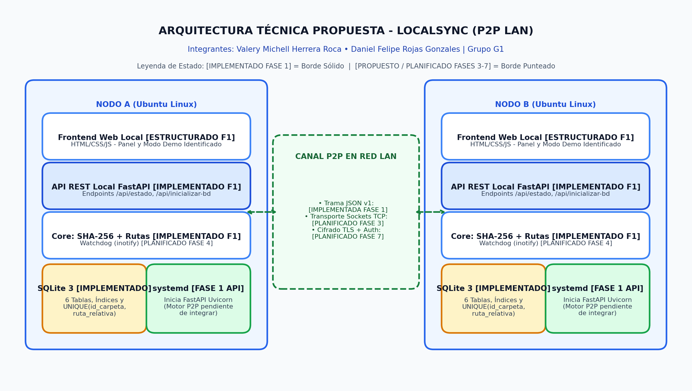
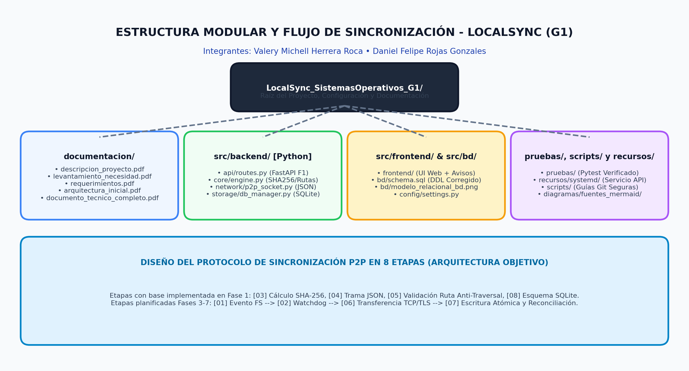
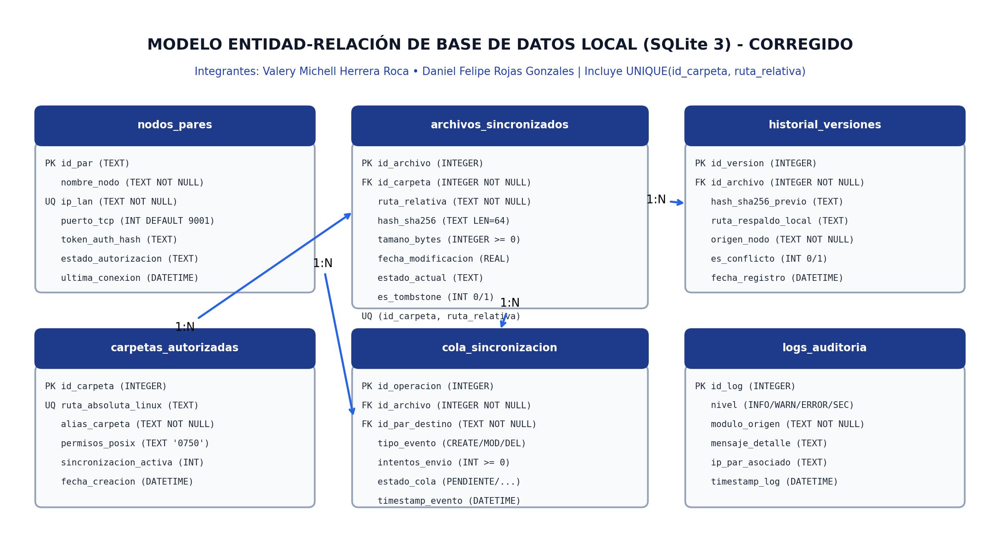

# 🔄 LocalSync — Sistema P2P de Sincronización de Archivos en Redes Locales


-0284C7?style=for-the-badge)


**Universidad Manuela Beltrán** • Programa de Ingeniería de Software • Asignatura: **Sistemas Operativos**  
**Grupo:** G1 • **Repositorio:** `LocalSync_SistemasOperativos_G1`

---

## 👥 1. Integrantes Oficiales del Equipo (Grupo G1)

| Nombre Completo | Responsabilidades Principales en el Proyecto |
| :--- | :--- |
| **Valery Michell Herrera Roca** | Diseño del Modelo Relacional SQLite, Especificación de Requerimientos (RF/RNF), API Local FastAPI y Documentación Técnica |
| **Daniel Felipe Rojas Gonzales** | Estructura del Motor Core (SHA-256 / Rutas), Protocolo P2P, Interfaz Web Local, Servicio `systemd` y Pruebas Automatizadas |

---

## 📌 2. Descripción General del Proyecto

**LocalSync** es una propuesta y prototipo en desarrollo de una aplicación web local para computadores con **Ubuntu Linux** conectados a una misma red de área local (**LAN**). Su propósito es permitir la sincronización directa de archivos mediante una arquitectura **Punto a Punto (P2P)**, sin utilizar un servidor central, sin almacenamiento en la nube y sin depender de servicios externos para la transferencia de datos.

---

## ⚠️ 3. Problema o Necesidad y Justificación

### Planteamiento del Problema y Necesidad
En laboratorios universitarios, oficinas técnicas y entornos educativos basados en Linux, el intercambio manual de archivos (memorias USB, copias manuales o aplicaciones de mensajería) ocasiona pérdida silenciosa de cambios, proliferación de versiones desactualizadas y duplicidad de información. Por otra parte, las plataformas de almacenamiento en la nube no son viables cuando no hay conectividad a internet o cuando existen políticas estrictas de privacidad dentro de la red local.

> **Pregunta Problema:** *¿Cómo desarrollar una aplicación web para Linux que permita sincronizar archivos directamente entre dos equipos conectados a una red local, sin depender de servicios externos de almacenamiento, gestionando integridad, desconexiones y conflictos de modificación?*

### Justificación Académica y Técnica (Relación con Sistemas Operativos)
El proyecto permite aplicar y evaluar de manera experimental conceptos esenciales de **Sistemas Operativos**:
1. **Sistema de Archivos y Llamadas de E/S:** Lectura por bloques de memoria para hashing criptográfico (`SHA-256`), manejo de permisos `POSIX` y validación de rutas canónicas contra ataques *Path Traversal*.
2. **Monitoreo de Eventos del Kernel:** Observación de eventos de directorios en Linux (`inotify` mediante `Watchdog`, planificado para Fase 4).
3. **Procesos, Hilos y Demonios del Sistema:** Ejecución supervisada en segundo plano con `systemd` bajo privilegios mínimos.
4. **Comunicación entre Procesos en Red (IPC):** Diseño de protocolo directo sobre **Sockets TCP** con seguridad **TLS** y tolerancia a desconexiones mediante una cola local en **SQLite 3**.

---

## 🎯 4. Objetivos del Proyecto

### Objetivo General
Desarrollar y evaluar una aplicación web para Linux con arquitectura P2P que permita sincronizar archivos entre dos equipos en red local, incorporando detección de cambios, transferencia directa, verificación de integridad, gestión de conflictos y recuperación de versiones, sin servicios externos de almacenamiento.

### Objetivos Específicos
1. **Investigar** mecanismos de sincronización en red local y analizar soluciones referentes (*Syncthing*).
2. **Implementar** un motor detector de archivos nuevos, modificados y eliminados en el sistema de archivos Linux.
3. **Desarrollar** una interfaz web local para configurar pares autorizados, consultar el estado y revisar el historial.
4. **Diseñar** una arquitectura de comunicación directa y autenticada entre nodos en Linux mediante Sockets TCP.
5. **Incorporar** verificación criptográfica de integridad (`SHA-256`) y conservación de versiones en conflicto.
6. **Evaluar** el prototipo mediante pruebas reproducibles de desconexión, concurrencia y rendimiento en red LAN.

---

## 🔭 5. Alcance Inicial, Usuarios y Beneficiarios

* **Alcance Inicial Incluido:**
  * Sincronización diseñada para operar entre **2 instancias con Ubuntu Linux** conectadas en red local (LAN).
  * Autorización manual de pares, protocolo de transferencia directa por **Sockets TCP** y verificación **SHA-256**.
  * Diseño de manejo de conflictos sin sobrescritura silenciosa, registros de borrado (*tombstones*), historial de versiones y cola persistente en **SQLite 3**.
  * Panel web local (`HTML/CSS/JS`) comunicado con una API local en `FastAPI`.
* **Fuera del Alcance (Limitaciones):**
  * Sincronización a través de internet pública, almacenamiento en nube central, edición colaborativa simultánea sobre un mismo archivo en tiempo real, soporte multiplataforma completo fuera de Linux o topologías masivas de nodos.
* **Usuarios y Beneficiarios:**
  * Estudiantes, docentes, laboratorios de cómputo universitario y equipos de desarrollo en entornos Ubuntu Linux que requieren sincronizar directorios de trabajo dentro de una red local privada.

---

## ⚙️ 6. Funcionalidades Principales (Diseño del Producto)

1. **Sincronización Bidireccional P2P:** Ambos nodos están diseñados para actuar como cliente y servidor en la red local.
2. **Verificación de Integridad con SHA-256:** Comprobación criptográfica por bloques de lectura antes de dar por válida una versión.
3. **Gestión de Conflictos sin Sobrescritura Silenciosa:** Conservación de copias conflictivas en el historial local cuando un archivo se modifica en ambos nodos antes de reconciliar.
4. **Propagación de Eliminaciones (*Tombstones*) y Cola Persistente:** Registro de borrados e inserción de eventos pendientes en `SQLite 3` cuando el par remoto no está disponible.
5. **Seguridad de Rutas y Control de Acceso:** Validación estricta contra *Path Traversal*, autorización de pares, canal TLS previsto y servicio `systemd` con privilegios mínimos.

---

## 🔍 7. Estado Actual Real del Proyecto (Transparencia Técnica — Entrega 1)

| Categoría de Estado | Componentes del Proyecto | Detalle de Verificación Real |
| :--- | :--- | :--- |
| **🟢 1. Implementado y Comprobado (Fase 1)** | • Esquema de Base de Datos SQLite (`src/bd/schema.sql`)<br>• Gestor SQLite (`src/backend/storage/db_manager.py`)<br>• Cálculo de Hash SHA-256 (`calcular_sha256`)<br>• Validador Anti-Path Traversal (`validar_ruta_segura`)<br>• Serializador de Mensajes P2P (`NodoP2PTCP`)<br>• API REST Local (`src/backend/api/routes.py`)<br>• Suite de Pruebas (`pruebas/test_integridad_y_rutas.py`) | Compilados en Python, validados con creación real de tablas e índices en SQLite (incluyendo `UNIQUE(id_carpeta, ruta_relativa)`) y comprobados mediante pruebas automatizadas. |
| **🟡 2. Estructurado (Parcial / En Integración)** | • Interfaz Web Local (`src/frontend/index.html`, `css`, `js`)<br>• Clase `MotorSincronizacionLocal` (`engine.py`)<br>• Unidad `systemd` (`recursos/systemd/localsync.service`) | La UI consulta `/api/estado` e identifica explícitamente los datos de demostración (`[DATO SIMULADO - DEMO UI]`). El archivo `localsync.service` inicia actualmente la API `FastAPI` con `Uvicorn`. |
| **⚪ 3. Planificado para Próximas Fases (Fases 2 a 8)** | • Transporte de red bidireccional por Sockets TCP (Fase 3)<br>• Monitoreo en vivo con `Watchdog` / `inotify` (Fase 4)<br>• Reconciliación de conflictos y *tombstones* (Fase 5)<br>• Canal cifrado TLS y autenticación de red (Fase 7) | Documentados en la arquitectura y diagramas como componentes propuestos del cronograma semestral; aún no ejecutan transferencias reales por red. |

---

## 🏗️ 8. Arquitectura P2P y Modelo Entidad-Relación

### Diagrama de Arquitectura P2P (Estado Fase 1 vs. Planificado)


### Diagrama de Estructura del Producto y Flujo de 8 Etapas


### Modelo Entidad-Relación SQLite 3 (Corregido con Restricción Compuesta)


> Las fuentes editables en formato **Mermaid (`.mmd`)** se encuentran en [`documentacion/diagramas/fuentes_mermaid/`](documentacion/diagramas/fuentes_mermaid/).

---

## 🛠️ 9. Tecnologías Utilizadas y Previstas

| Componente | Tecnología | Estado en Entrega 1 | Función en el Sistema |
| :--- | :--- | :--- | :--- |
| **Sistema Operativo** | `Ubuntu Linux` | Definido | Entorno de ejecución, permisos POSIX y red local. |
| **Lenguaje / Motor** | `Python 3.10+` | Implementado (Base) | Lógica de integridad SHA-256, validación de rutas y protocolos. |
| **API Local** | `FastAPI 0.115.0` | Implementado | Expone `/api/estado`, `/api/inicializar-bd` y `/api/control/pausa`. |
| **Servidor ASGI** | `Uvicorn 0.30.6` | Implementado | Ejecuta la API local en `127.0.0.1:8080`. |
| **Interfaz Web** | `HTML5 / CSS3 / JS` | Estructurado | Panel web local con separación entre datos reales y simulados. |
| **Base de Datos** | `SQLite 3` | Implementado | Persistencia de las 6 tablas con `FOREIGN KEY` y `UNIQUE(id_carpeta, ruta_relativa)`. |
| **Integridad** | `SHA-256 (hashlib)` | Implementado | Verificación criptográfica de archivos por bloques de 64 KB. |
| **Pruebas** | `pytest 8.3.3` | Implementado | Validación automatizada de módulos, base de datos y API. |
| **Servicio Linux** | `systemd` | Configurado (API) | Unidad de servicio para iniciar la API local con privilegios mínimos. |
| **Comunicación P2P** | `Sockets TCP` | Planificado (Fase 3) | Serialización JSON implementada; transporte de red en Fase 3. |
| **Monitoreo FS** | `Watchdog 5.0.2` | Planificado (Fase 4) | Dependencia declarada; integración con eventos de disco en Fase 4. |
| **Seguridad Red** | `TLS (ssl)` | Planificado (Fase 7) | Canal cifrado punto a punto entre nodos autorizados. |

---

## 📂 10. Estructura de Carpetas del Repositorio

```text
LocalSync_SistemasOperativos_G1/
│
├── README.md
├── LICENSE
├── requirements.txt
├── .gitignore
├── subir_a_github.ps1
├── subir_a_github.sh
│
├── config/
│   ├── __init__.py
│   ├── settings.py
│   └── localsync.env.example
│
├── documentacion/
│   ├── descripcion_proyecto.pdf
│   ├── requerimientos.pdf
│   ├── arquitectura_inicial.pdf
│   ├── sistemas_operativos.pdf
│   ├── modelo_relacional.pdf
│   ├── tecnologias_herramientas.pdf
│   ├── documento_tecnico_completo.pdf
│   ├── levantamiento_informacion/
│   │   └── levantamiento_necesidad_problematica.pdf
│   └── diagramas/
│       ├── arquitectura_inicial.png
│       ├── estructura_producto.png
│       ├── modelo_relacional_bd.png
│       ├── Ficha_Tecnica_LocalSync.jpg
│       └── fuentes_mermaid/
│           ├── arquitectura_p2p.mmd
│           ├── estructura_y_flujo.mmd
│           ├── flujo_sincronizacion_8_etapas.mmd
│           └── modelo_relacional.mmd
│
├── src/
│   ├── __init__.py
│   ├── backend/
│   │   ├── __init__.py
│   │   ├── api/
│   │   │   ├── __init__.py
│   │   │   └── routes.py
│   │   ├── core/
│   │   │   ├── __init__.py
│   │   │   └── engine.py
│   │   ├── network/
│   │   │   ├── __init__.py
│   │   │   └── p2p_socket.py
│   │   └── storage/
│   │       ├── __init__.py
│   │       └── db_manager.py
│   ├── frontend/
│   │   ├── index.html
│   │   ├── css/styles.css
│   │   └── js/app.js
│   └── bd/
│       ├── schema.sql
│       └── modelo_relacional_bd.png
│
├── recursos/
│   ├── systemd/
│   │   └── localsync.service
│   └── imagenes/
│       └── Ficha_Tecnica_LocalSync.jpg
│
├── scripts/
│   ├── subir_a_github.ps1
│   └── subir_a_github.sh
│
└── pruebas/
    ├── __init__.py
    └── test_integridad_y_rutas.py
```

---

## 💻 11. Requisitos de Hardware/Software e Instrucciones de Ejecución

```bash
cd LocalSync_SistemasOperativos_G1
python3 -m venv venv
source venv/bin/activate
pip install -r requirements.txt

# Ejecutar pruebas automatizadas (compatible con pytest y unittest)
pytest -v
python3 -m unittest discover -s pruebas -v

# Iniciar API local FastAPI
uvicorn src.backend.api.routes:app --host 127.0.0.1 --port 8080
```

---

## 📈 12. Cronograma y Próximos Pasos (Plan de 8 Fases)

1. **Fase 1 (Semana 1) — Investigación, Diseño y Estructuración [ESTADO ACTUAL]**
2. **Fase 2 (Semana 2) — Entorno Linux LAN**
3. **Fase 3 (Semana 3) — Red P2P por Sockets TCP**
4. **Fase 4 (Semana 4) — Motor de Sincronización (`Watchdog`)**
5. **Fase 5 (Semana 5) — Recuperación y Tolerancia a Fallos**
6. **Fase 6 (Semana 6) — Integración Completa de la Interfaz Web**
7. **Fase 7 (Semana 7) — Seguridad Operativa (`TLS` y `systemd`)**
8. **Fase 8 (Semana 8) — Evaluación Experimental**
