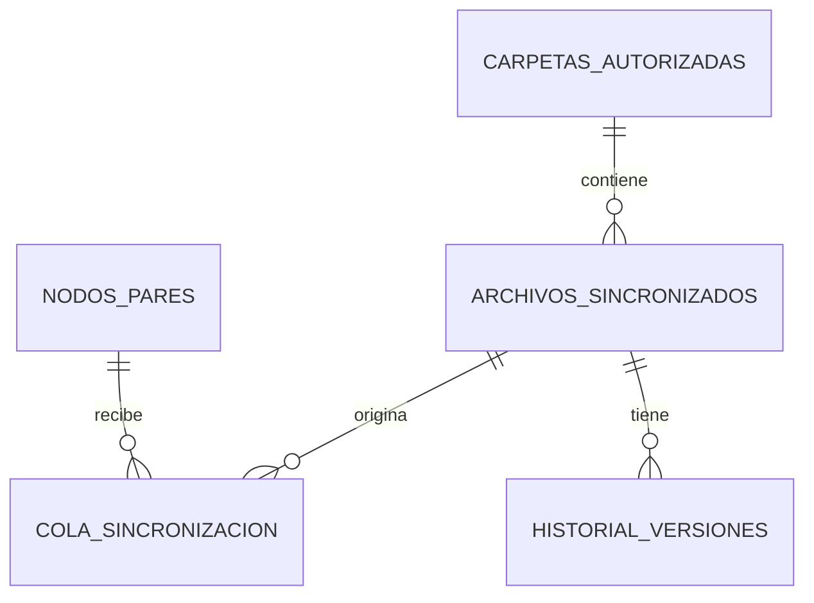
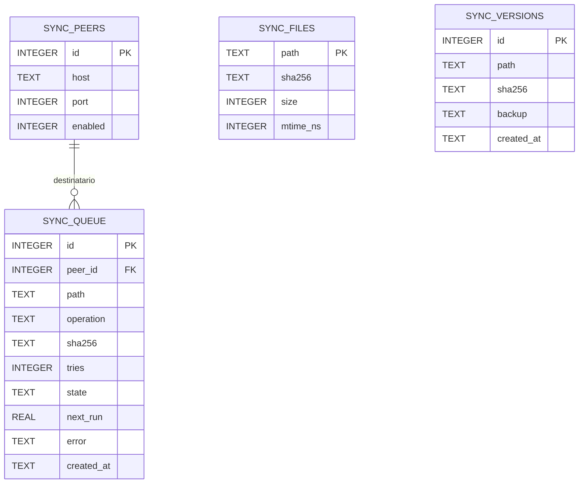

# Referencia de API REST, configuración y persistencia

**Versión declarada por FastAPI:** `0.4.0-sync` · **Base:** `http://127.0.0.1:8080` · **Swagger:** `/docs` · **Esquema JSON:** `/openapi.json`.

## 1. Modelo de comunicación

- La GUI realiza solicitudes HTTP **solo a su API local**. No se debe servir desde `0.0.0.0:8080`.
- La API local desencadena **conexiones TCP** salientes a una IPv4 privada del receptor, o inicia un receptor local dentro del proceso.
- Los archivos preparados se guardan en `archivos_para_enviar/` y los recibidos en `archivos_recibidos/`.
- Para cargar archivos se usa `multipart/form-data`. Para las otras operaciones `POST` / `PATCH` / `DELETE` se usa JSON.
- Las direcciones remotas deben ser IPv4 privadas válidas o loopback; el API antiguo `/api/p2p` posee además un control de destinatario por `LOCALSYNC_PAR_LAN`.
- La interfaz de administración **no** expone la API a otras PC. La comunicación remota usa el puerto **TCP 9001**.

## 2. Endpoints administrativos y diagnóstico

| Método | Ruta | Entrada principal | Salida / alcance |
| --- | --- | --- | --- |
| `GET` | `/` | — | HTML de la GUI |
| `GET` | `/api/estado` | — | Componentes, sistema operativo y diagnóstico SQLite |
| `POST` | `/api/inicializar-bd` | — | Inicialización de esquema SQL |
| `POST` | `/api/control/pausa` | `{"pausar":true}` | Detiene la vigilancia automática, no el receptor TCP manual |
| `GET` | `/api/lan/estado` | — | Receptor, contadores, últimos eventos |
| `GET` | `/api/lan/red` | — | IPv4 locales detectadas (orientativo) |
| `GET` | `/api/lan/archivos` | — | Listas de archivos de envío y recepción |

Ejemplo para consultar estado:

```bash
curl http://127.0.0.1:8080/api/lan/estado
```

**Arquitectura de datos:** existen dos bases separadas. El esquema académico inicial conserva sus tablas, mientras que el motor nuevo opera con `datos_locales/sync.db` y una cola, archivos y versiones que sí se actualizan automáticamente.

## 3. Endpoints de archivos

| Método | Ruta | Entrada | Resultado |
| --- | --- | --- | --- |
| `POST` | `/api/lan/archivos` | Multipart: `archivo` (File) y `ruta` (Form opcional) | Guarda un archivo en bandeja de envíos |
| `GET` | `/api/lan/descargar?ruta=...` | Ruta relativa de archivo recibido | Descarga desde la bandeja de recepción |
| `GET` | `/api/lan/archivo/verificar?ruta=...&bandeja=...` | `bandeja`: `envios` o `recibidos` | Hash SHA-256 y tamaño |
| `PATCH` | `/api/lan/archivo` | `bandeja`, `ruta`, `nuevo_nombre` | Renombra un archivo **local**, sin sobrescribir |
| `DELETE` | `/api/lan/archivo` | `bandeja`, `ruta` | Borra un archivo **local** |

### Ejemplo: preparar archivo

```bash
curl -X POST "http://127.0.0.1:8080/api/lan/archivos" \
  -F "archivo=@ejemplo.txt" -F "ruta=entregas/ejemplo.txt"
```

`ruta` debe ser relativa a la carpeta autorizada. En caso de nombre existente con contenido diferente, la bandeja de envío genera nombre alterno para evitar sobrescribirlo sin autorización.

### Ejemplo: verificar

```bash
curl "http://127.0.0.1:8080/api/lan/archivo/verificar?bandeja=envios&ruta=entregas%2Fejemplo.txt"
```

Respuesta con `ruta`, `bandeja`, `sha256` (64 hex) y `tamano`.

### Ejemplo: renombrar

```bash
curl -X PATCH "http://127.0.0.1:8080/api/lan/archivo" \
  -H "Content-Type: application/json" \
  -d '{"bandeja":"envios","ruta":"entregas/ejemplo.txt","nuevo_nombre":"ejemplo-final.txt"}'
```

`nuevo_nombre` es **solo un nombre**, sin barras ni segmentos de directorios. Un conflicto devuelve `409`. Borrar en el panel **no envía** un comando de borrado al otro equipo.

## 4. Conexión y transferencias

| Método | Ruta | Entrada JSON | Respuesta |
| --- | --- | --- | --- |
| `POST` | `/api/lan/conexion` | `host`, `puerto`, `token` opcional | `conectado` y `detalle` PING/ACK |
| `POST` | `/api/lan/enviar` | `host`, `puerto`, `token`, `ruta`, `reintentos` | `enviado`, archivo y SHA-256 |
| `POST` | `/api/lan/enviar-carpeta` | `host`, `puerto`, `token`, `subcarpeta`, `prefijo` | `correctos`, `errores`, mensaje |
| `POST` | `/api/lan/receptor/iniciar` | `modo_lan`, `puerto`, `token` | Receptor activo, host y puerto |
| `POST` | `/api/lan/receptor/detener` | `{}` | Receptor detenido |

`host` admite IPv4 de LAN o `127.0.0.1`; no dominios arbitrarios. Puerto admitido: 1024–65535. `reintentos` en este endpoint admite de 0 a 3. El parámetro `ruta` indica un archivo **ya preparado**, no una ruta absoluta del sistema.

Ejemplo de iniciar un receptor local (sin abrir LAN):

```bash
curl -X POST http://127.0.0.1:8080/api/lan/receptor/iniciar \
  -H "Content-Type: application/json" -d '{"modo_lan":false,"puerto":9001}'
```

Ejemplo para comprobar conectividad local:

```bash
curl -X POST http://127.0.0.1:8080/api/lan/conexion \
  -H "Content-Type: application/json" \
  -d '{"host":"127.0.0.1","puerto":9001}'
```

**Para LAN física** el token de al menos 16 caracteres debe coincidir en ambos equipos. Se puede activar `reanudar:true` en el envío manual. Para réplica A↔B, al iniciar el receptor usar `carpeta_compartida:true`, con autenticación HMAC. Los borrados necesitan además `permitir_borrado:true`, siempre de forma explícita. No incluir tokens reales en comandos, capturas ni logs públicos.

### Ruta de compatibilidad

`/api/p2p/conexion` (GET) y `/api/p2p/enviar` (POST) siguen disponibles para el panel anterior. La ruta de envío utiliza el campo `nombre` (nombre directo, sin subdirectorios), `host` y `puerto`. Para IPv4 remota privada distinta de loopback la API anterior exige además que `LOCALSYNC_PAR_LAN` coincida con el destino. **Se recomienda usar `/api/lan` para las funciones actuales de la GUI**.

## 5. Laboratorio virtual

| Método | Ruta | Descripción |
| --- | --- | --- |
| `GET` | `/api/lan/simulacion/estado` | Estado, hora de inicio/fin, logs y disponibilidad de Docker |
| `POST` | `/api/lan/simulacion/iniciar` | Inicia la simulación de dos contenedores Linux Docker |
| `POST` | `/api/lan/simulacion/local` | Ejecuta dos nodos TCP locales sin Docker |
| `POST` | `/api/lan/simulacion/limpiar` | Elimina recursos del laboratorio Docker |
| `GET` | `/api/lan/simulacion/evidencia` | Descarga registro de texto de la última ejecución |

Estados mostrados: `sin_ejecutar`, `ejecutando`, `aprobado` y `fallido`. **Resultado aprobado** se obtiene únicamente tras completar el proceso de prueba. Tras una limpieza correcta, el estado vuelve a `sin_ejecutar`. La salida de laboratorio se conserva **en la memoria del proceso web**, no como archivo persistente.

## 6. Esquema SQLite (diseño presente, uso parcial)

Archivo: `src/bd/schema.sql`. Gestor: `src/backend/storage/db_manager.py`.



| Tabla | Claves / propósito | ¿Se alimenta automáticamente tras enviar un archivo? |
| --- | --- | --- |
| `nodos_pares` | Identidad y autorización prevista de nodos | **No** |
| `carpetas_autorizadas` | Directorios y permisos POSIX | **No** |
| `archivos_sincronizados` | Rutas, hashes, tamaños, estados, tombstones | **No** |
| `historial_versiones` | Versiones y conflictos futuros | **No** |
| `cola_sincronizacion` | Reintentos persistentes previstos | **No** |
| `logs_auditoria` | Registros persistentes previstos | **No** |

`GestorBaseDatosLocal` conserva las utilidades del esquema original. La sincronización nueva utiliza **una segunda base operativa** gestionada por `src/backend/sync/engine.py`, con cola y versiones persistentes. El historial de transferencias manuales `/api/lan/estado` sigue siendo un `deque(maxlen=60)` en RAM; el estado del motor automático se consulta por `/api/sync/estado`.

## 7. Variables de configuración

| Nombre | Uso efectivo |
| --- | --- |
| `LOCALSYNC_AUTH_TOKEN` | Token compartido cliente/receptor; preferir variable de entorno |
| `LOCALSYNC_P2P_PORT` | Puerto por defecto del cliente y receptor CLI |
| `LOCALSYNC_TLS_CA` | Ruta de CA/certificado confiable para conexiones desde API LAN |
| `LOCALSYNC_TLS_SERVER_NAME` | Nombre/IP esperado por cliente TLS |
| `LOCALSYNC_PAR_LAN` | Par autorizado para ruta antigua `/api/p2p` |
| `LOCALSYNC_DB_PATH` | Ruta SQLite local |
| `LOCALSYNC_SCHEMA_PATH` | Ruta del archivo SQL |
| `LOCALSYNC_API_HOST` / `LOCALSYNC_API_PORT` | Valores de configuración; los iniciadores provistos escuchan explícitamente en `127.0.0.1:8080` |
| `LOCALSYNC_DEMO_MODE` | Variable histórica de configuración; el endpoint actual reporta `es_simulacion: false` |

El archivo `config/localsync.env.example` **no se carga automáticamente** al iniciar FastAPI: establece las variables en el entorno del proceso o configura un servicio. No comprometas secretos en Git.

## 8. Validación y códigos de respuesta

| Código / caso | Causa habitual |
| --- | --- |
| `200` | Consulta o acción completada |
| `400` | IP, ruta, nombre, puerto o política inválidos |
| `404` | Archivo no encontrado |
| `409` | Receptor ya activo o destino de renombrado ocupado |
| `413` | Archivo superior a 100 MiB al cargar desde web |
| `502` | Fallo en transferencia hacia receptor remoto |
| `503` | Docker no disponible o receptor no pudo iniciarse |

Un `POST /api/lan/conexion` puede devolver **HTTP 200 con `conectado:false`**, ya que representa un diagnóstico de red. Valida siempre ese campo antes de asumir éxito.

**Fuente de verdad:** modelos de `src/backend/api/lan_routes.py` y `src/backend/api/sync_routes.py`; puedes consultar el esquema ejecutable en `/openapi.json`. Ver [protocolo TCP](PROTOCOLO_TCP.md) y [errores](SEGURIDAD_Y_ERRORES.md).


## 9. API de sincronización automática (implementada)

La API **solo** es accesible desde `127.0.0.1:8080`. La GUI invoca estos endpoints con JSON:

| Método | Endpoint | Entrada | Resultado |
| --- | --- | --- | --- |
| `GET` | `/api/sync/estado` | — | Vigilancia activa, Watchdog, carpeta, pares, cola y errores |
| `POST` | `/api/sync/pares` | `{"host":"192.168.1.25","port":9001,"token":"..."}` | Añade par autorizado por clave; **token solo en RAM** |
| `DELETE` | `/api/sync/pares/{peer_id}` | ID numérico | Retira el par y sus trabajos pendientes |
| `POST` | `/api/sync/iniciar` | `{"propagate_deletes":false}` | Activa vigilancia y despachador de cola |
| `POST` | `/api/sync/detener` | `{}` | Detiene Watchdog y el despachador |
| `POST` | `/api/sync/escanear` | `{}` | Fuerza un escaneo de la carpeta configurada |
| `GET` | `/api/sync/versiones` | `path` opcional | Lista versiones indexadas por SHA-256 |
| `POST` | `/api/sync/restaurar` | `{"version_id":1}` | Restaura un respaldo en carpeta vigilada |

### API LAN extendida

- `POST /api/lan/descubrir`: busca receptores firmados con el mismo token mediante UDP 9002 y devuelve `equipos`. **No los añade automáticamente a la lista de pares.**
- `POST /api/lan/receptor/iniciar`: campos adicionales `carpeta_compartida` y `permitir_borrado` (ambos falsos por defecto). El primero permite aplicar los cambios entrantes directamente sobre la carpeta vigilada, con respaldo de la versión anterior.
- `POST /api/lan/enviar` y `/enviar-carpeta`: campo `reanudar` habilita `CREATE_RESUME` y la negociación del offset.
- `POST /api/control/pausa`: detiene el motor automático cuando `pausar=true`; no detiene el socket receptor manual.

## 10. SQLite operativa y recuperación



- `sync_files`: snapshot de ruta, tamaño, modificación y SHA.
- `sync_peers`: pares autorizados con host y puerto, **sin token en la tabla**.
- `sync_queue`: pendiente por par/ruta (CREATE/DELETE), intento y próximo reenvío; se mantiene después de reiniciar.
- `sync_versions`: referencia a copias respaldadas por hash y fecha; la GUI permite recuperar una versión concreta.
- `src/bd/schema.sql`: estructura académica **heredada**, independiente de la base operativa.

## 11. Configuración y despliegue

Para arranque sin interacción en Ubuntu se admiten `LOCALSYNC_AUTOSTART=1`, `LOCALSYNC_SYNC_PEER`, `LOCALSYNC_SYNC_PEER_PORT`, `LOCALSYNC_AUTH_TOKEN`, `LOCALSYNC_ALLOW_REMOTE_DELETE` y rutas `LOCALSYNC_SYNC_DIR`, `LOCALSYNC_SYNC_DB`, `LOCALSYNC_VERSIONS_DIR`, `LOCALSYNC_UPLOAD_DIR`, `LOCALSYNC_RECEIVE_DIR`. TLS puede configurarse con `LOCALSYNC_TLS_CERT`, `LOCALSYNC_TLS_KEY`, `LOCALSYNC_TLS_CA` y `LOCALSYNC_TLS_SERVER_NAME`.

**Nunca** pongas el token real en ejemplos, archivos compartidos o parámetros públicos. Consulta [Despliegue final](DESPLIEGUE_FINAL.md) y [Seguridad](SEGURIDAD_Y_ERRORES.md).
