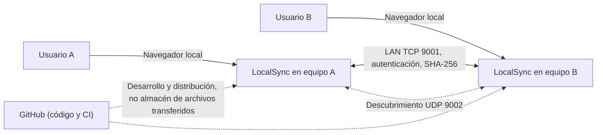
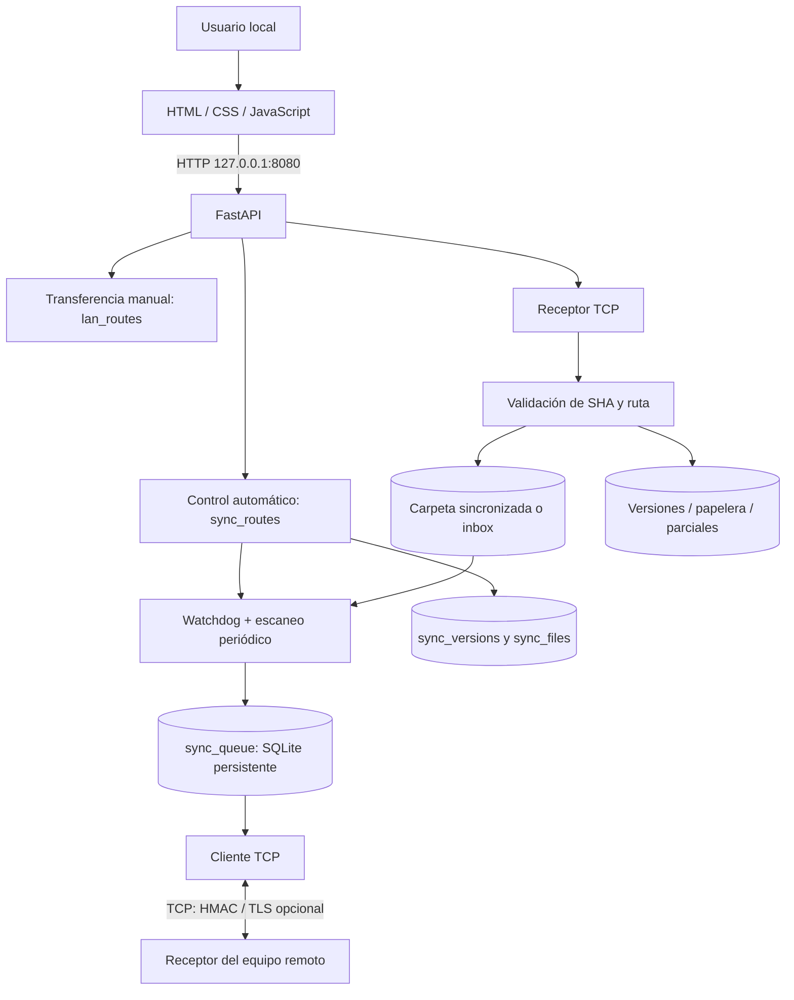
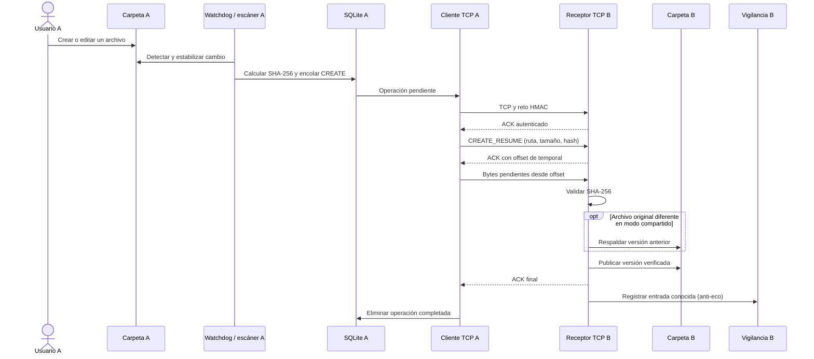
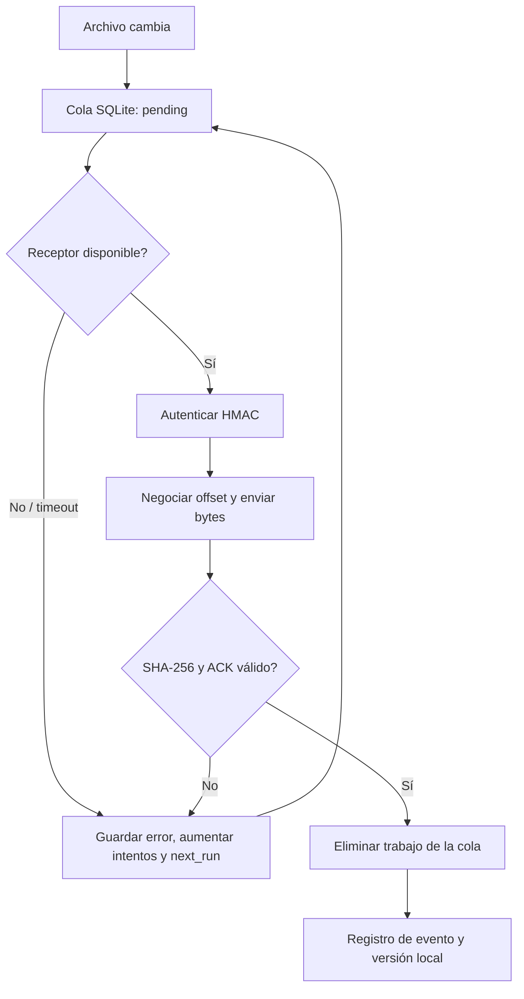
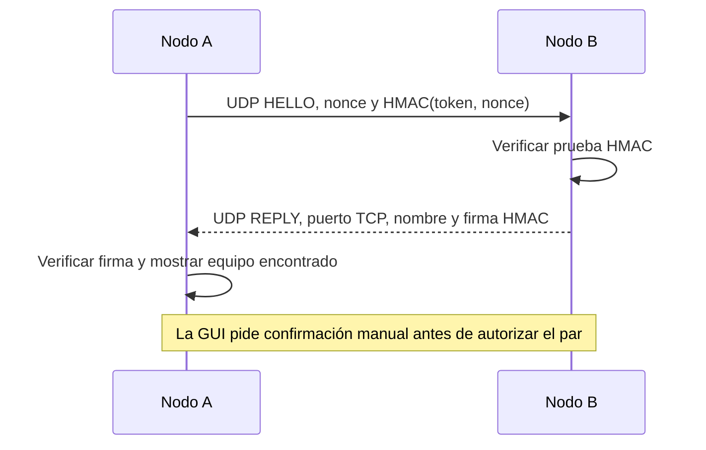
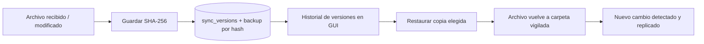

# Arquitectura técnica — LocalSync LAN Engine

**Revisión:** 18-11-2026 · **Versión interna de API:** `0.4.0-sync` · **Implementación de referencia:** rama `main`.

## 1. Propósito del sistema

LocalSync conecta dos computadores en una LAN para **transferir archivos y sincronizar cambios en carpetas autorizadas** mediante TCP. No depende de almacenamiento en la nube para mover los bytes. Las personas controlan cada instancia desde una interfaz FastAPI que **solo escucha en localhost**, mientras el receptor TCP acepta conexiones autenticadas desde la LAN.

### Alcance implementado

- Envío manual o automático de archivos y carpetas, SHA-256, ACK, TLS opcional, HMAC.
- Vigilancia por Watchdog + exploración de respaldo para detectar creación, modificación y borrado.
- Persistencia de operaciones y errores pendientes en SQLite; reintentos tras reconexión.
- Reanudación de transmisión parcial por hash y desplazamiento negociado con el receptor.
- Replicación automática A ↔ B al configurar los dos pares y la carpeta compartida.
- Respaldo de versiones anteriores previo a reemplazo y restauración desde la GUI.
- Descubrimiento de equipos UDP 9002 firmado con HMAC, sin asociación automática.
- Eliminaciones remotas opcionales con papelera recuperable.

**Límite de consistencia:** no hay un protocolo de consenso para ediciones concurrentes en distintos nodos. En el modo compartido, la última versión **aplicada** ocupa el nombre original y el contenido anterior permanece en respaldos. El orden de llegada puede variar entre nodos si hay ediciones simultáneas.

## 2. Diagrama de contexto

## 3. Diagrama de componentes por nodo

Las operaciones manuales pueden usar una carpeta de recepción separada. La réplica automática entre **dos** equipos exige marcar explícitamente **Recibir directamente en carpeta sincronizada** al iniciar el receptor; entonces el motor distingue los eventos entrantes para evitar devolverlos inmediatamente al origen.

## 4. Responsabilidades reales del código

| Ruta / componente | Función |
| --- | --- |
| `src/frontend/index.html` | Resumen, Transferencias, Sincronización, Laboratorio y Actividad |
| `src/frontend/js/app.js` | Estado, controles, selección/gestión y llamadas HTTP locales |
| `src/backend/api/routes.py` | FastAPI, middleware de loopback y autostart opcional |
| `src/backend/api/lan_routes.py` | Receptor, archivos, envíos, búsqueda de equipos y laboratorio |
| `src/backend/api/sync_routes.py` | Pares, activar/detener sync, cola, versiones y restauración |
| `src/backend/sync/engine.py` | Watchdog, escaneo, SQLite, reintentos, backups y supresión de ecos |
| `src/backend/sync/worker.py` | Proceso autónomo de réplica (sin API), usado en Docker |
| `src/backend/network/cliente_tcp.py` | PING, CREATE, CREATE_RESUME, DELETE autenticado y ACK |
| `src/backend/network/p2p_socket.py` | Servidor concurrente, HMAC, TLS, recepción y archivado |
| `src/backend/network/transferencia.py` | Rutas seguras, archivos temporales, SHA, publicación y reanudación |
| `src/backend/network/discovery.py` | Descubrimiento UDP autenticado; no asocia pares automáticamente |
| `src/backend/storage/db_manager.py` | Gestor del esquema relacional inicial de `src/bd/schema.sql` |
| `recursos/systemd/localsync-autosync.service` | Arranque automático de API + motor en Ubuntu |
| `simulacion/demo_autosync.py` | Prueba de dos Linux con cambios en ambos sentidos |

**Dos modelos SQLite:** `sync.db` es la base operativa **real** de cola, archivos y versiones. Las tablas antiguas de `src/bd/schema.sql` conservan el diseño académico inicial y **no sustituyen** las tablas operativas.

## 5. Secuencia de archivo nuevo o modificado

Si el destino está desconectado, el trabajo **permanece en SQLite** con contador de intentos y `next_run`. Los reintentos usan espera progresiva acotada. La fase automática no requiere pulsar **Enviar** después de iniciar la vigilancia.

## 6. Máquina de estados de una operación persistente

La cola en `sync.db` se conserva tras reiniciar. Las credenciales introducidas mediante GUI **no** se guardan en claro en la base; después de reiniciar hay que reautorizar el par o configurar un secreto protegido por variables de entorno en el despliegue.

## 7. Protocolo y reanudación

- Control JSON con longitud prefijada de cuatro bytes, operación `LOCALSYNC_P2P_V1` y tamaño/hash.
- `CREATE` envía archivo completo; `CREATE_RESUME` negocia desplazamiento de bytes de un temporal persistente bajo `.localsync_partials`.
- Solo se publica un archivo cuando **todos** sus bytes coinciden con el hash anunciado.
- Tras un corte de conexión, el temporal permanece para reanudar; si cambia el SHA del contenido origen, el nuevo intento usa otro identificador de parcial.
- Los nombres conflictivos del envío manual conservan variantes `.conflict-<sha>`; el receptor compartido usa `overwrite` **después de respaldar el contenido antiguo**.
- `DELETE` requiere token y configuración explícita del receptor; mueve el archivo a `.localsync_deleted` en vez de borrar permanentemente.

**Restricciones:** 100 MiB máximos por archivo, bloques de 64 KiB, ocho workers del servidor por defecto y puerto 9001 configurable. Los parciales viejos no tienen purga automática.

## 8. Descubrimiento y configuración de confianza

No existen dispositivos autorizados automáticamente por un broadcast. El firewall puede bloquear UDP 9002: en ese caso se utiliza la IPv4 manual.

## 9. Versiones, respaldo y recuperación

Los respaldos de versiones bajo `datos_locales/versiones` **no** son visibles como archivos replicados normales ni se incluyen en Git. Cuando se aplica una edición entrante sobre un archivo diferente, se almacena el estado anterior antes de reemplazarlo. **No** se garantiza una política de historial distribuido completamente ordenado para ediciones simultáneas.

## 10. Vista de despliegue y recursos

| Recurso | Windows GUI | Ubuntu systemd |
| --- | --- | --- |
| Panel | `127.0.0.1:8080` | `127.0.0.1:8080` |
| TCP | `9001` en LAN autorizada | `9001` en LAN autorizada |
| Descubrimiento | `9002/UDP` | `9002/UDP` |
| Raíz sincronizada | `carpeta_sincronizada/` | `/var/lib/localsync/shared` |
| Base de cola | `datos_locales/sync.db` | `/var/lib/localsync/sync.db` |
| Backups | `datos_locales/versiones/` | `/var/lib/localsync/versions` |
| Inicio | `iniciar_localsync.bat` | `localsync-autosync.service` |

El modo permanente en Linux usa `LOCALSYNC_AUTOSTART=1`, token fuerte y dirección del par; se mantiene HTTP en loopback. El servicio aplica mínimos privilegios y solo escribe en el directorio de datos de `/var/lib/localsync`.

## 11. Pruebas y criterios de aceptación

Se prueba: TCP manual y HMAC/TLS, restauración de versiones, desconexión/reintento, reanudación desde parcial, descubrimiento UDP, archivado de DELETE, réplica de cambios en ambos sentidos, supresión de ecos y GUI en Chrome. La matriz Windows/Ubuntu y la ejecución Docker se consultan en [GitHub Actions](https://github.com/Codeforgeettttt/localsync-lan-engine_SistemasOperativos_G1/actions).

**Queda como evaluación del despliegue real:** reglas de firewall de la red particular, configuración de certificados, servicio systemd en el equipo de destino, comportamiento en desconexiones prolongadas y evidencias de la sesión física.

## 12. Riesgos técnicos que no deben ocultarse

- **Conflictos simultáneos:** no hay consenso distribuido ni combinación automática de dos cambios a la vez; se conserva historial local para restaurar.
- **Cifrado:** sin certificados TLS configurados, HMAC autentica pero no cifra archivos.
- **Recuperación de espacio:** la política de retención y limpieza de parciales/respaldos se administra durante despliegue.
- **Disponibilidad:** la sincronización depende de que el proceso local, el receptor y la red estén activos.
- **Administración:** nunca exponer FastAPI a `0.0.0.0:8080`.

**Documentación asociada:** [Despliegue final](DESPLIEGUE_FINAL.md), [Protocolo TCP](PROTOCOLO_TCP.md), [API y SQLite](API_Y_DATOS.md), [Seguridad](SEGURIDAD_Y_ERRORES.md), [Pruebas](PRUEBAS_Y_VALIDACION.md), [Versionado del código](CONTROL_DE_VERSIONES.md).
