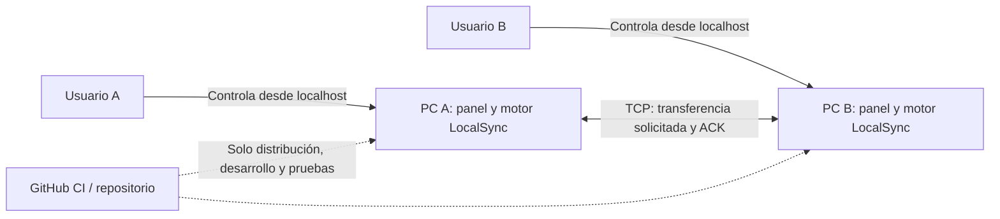
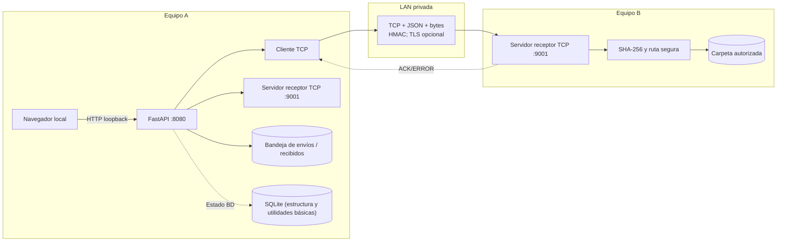
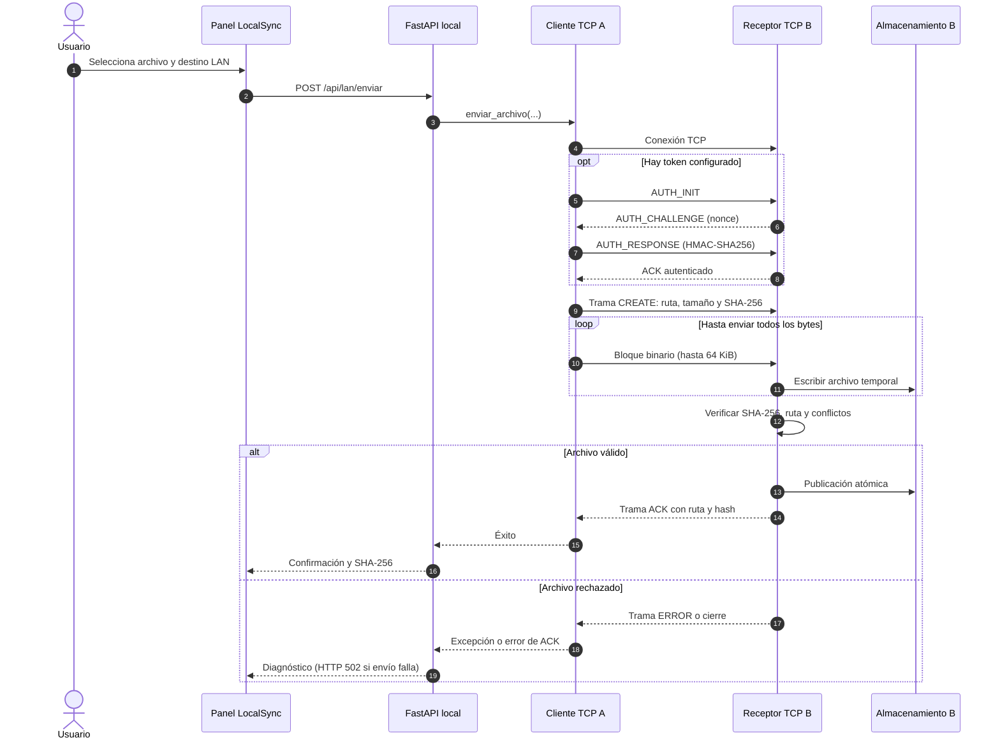
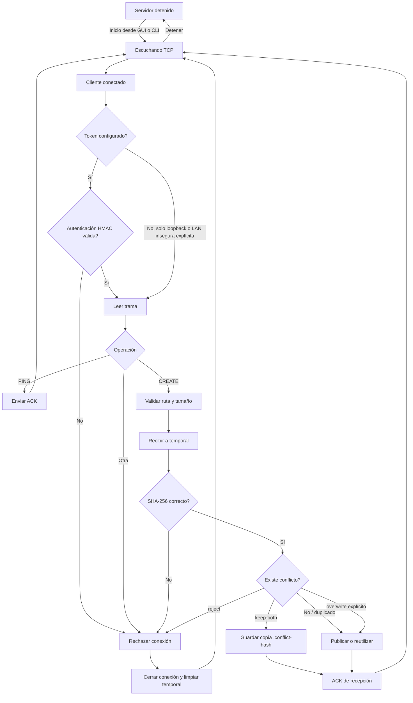
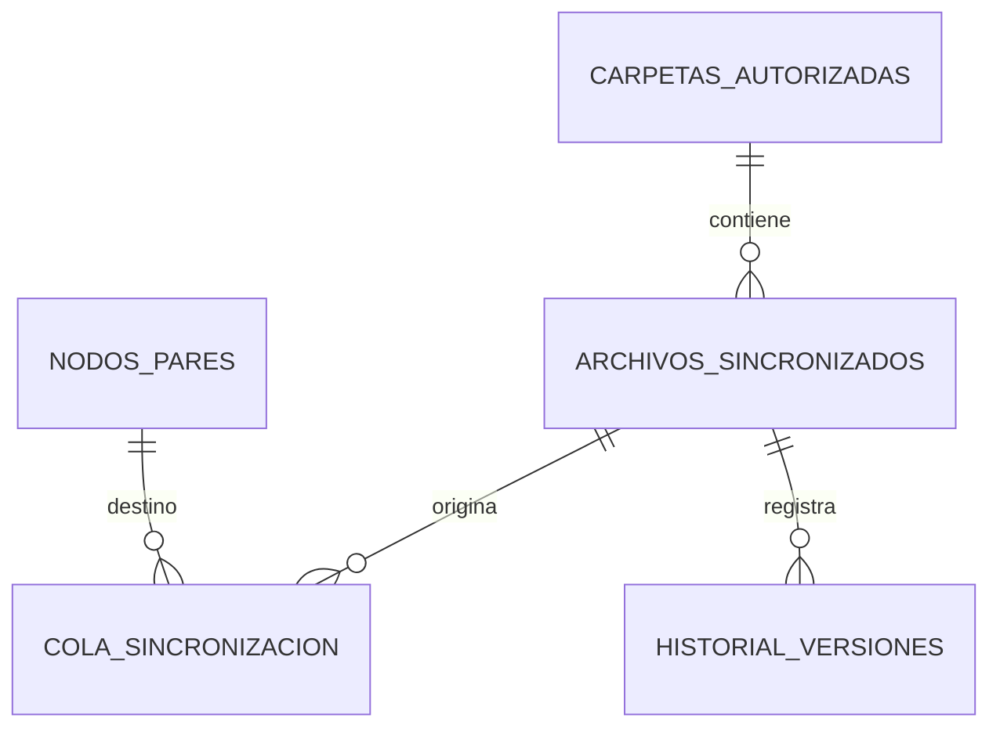

# Arquitectura técnica de LocalSync

**Edición:** 18-11-2026 · **Base técnica:** código de `main`, FastAPI `0.3.0-lan` · **Estado:** motor de transferencia manual implementado.

## 1. Objetivo arquitectónico

Permitir que dos equipos de una misma LAN intercambien archivos **sin subirlos a un servidor remoto o a la nube**, conservando la integridad de los datos y proporcionando una interfaz de control. Cada equipo puede asumir el rol de emisor o receptor en momentos diferentes: la aplicación no sincroniza carpetas automáticamente.

### Restricciones actuales

- El panel web se abre en **127.0.0.1:8080** para evitar que otra computadora de la LAN administre directamente la API.
- El receptor TCP puede escuchar en **0.0.0.0:9001** en modo LAN, sujeto a token HMAC compartido.
- El cliente se conecta a una dirección **IPv4 privada**, bajo la validación aplicada por la API.
- Un archivo puede medir **como máximo 100 MiB**. La transferencia usa bloques de **65 536 bytes**.
- La carpeta de recepción es un espacio autorizado; no puede construirse una ruta fuera de ella.
- TLS está implementado en el motor CLI, pero necesita configuración de certificados. **No se activa automáticamente al iniciar la GUI.**

## 2. Vista de contexto

**No hay un servidor central de transferencia.** GitHub se utiliza para versionar el código y ejecutar pruebas, no para almacenar los archivos que circulan por el canal TCP.

## 3. Vista de contenedores de software

En el sentido B → A se invierten los roles de emisor y receptor. El receptor de cada equipo es **un proceso/socket diferente** del servidor HTTP FastAPI.

## 4. Descomposición por módulos

| Módulo | Archivo | Responsabilidad | Estado |
| --- | --- | --- | --- |
| Shell de la interfaz | `src/frontend/index.html` | Navegación, zonas de envío, laboratorio y actividad | Implementado |
| Presentación | `src/frontend/css/styles.css` | Diseño responsive, mensajes y estados | Implementado |
| Control cliente | `src/frontend/js/app.js` | `fetch` a FastAPI, selección/carga y actualización de la GUI | Implementado |
| Servidor HTTP y middleware | `src/backend/api/routes.py` | Inicialización app, loopback, estado, pausa informativa, SQLite | Implementado |
| Endpoints de LAN | `src/backend/api/lan_routes.py` | Archivos, receptor, envíos, conexión y laboratorio Docker | Implementado |
| Compatibilidad P2P | `src/backend/api/p2p_routes.py` | API antigua con autorización de par por variable | Implementado |
| Cliente de transporte | `src/backend/network/cliente_tcp.py` | PING, HMAC, envíos por bloques, carpetas y reintentos | Implementado |
| Receptor socket | `src/backend/network/p2p_socket.py` | Accept, hilos, JSON, autenticación, ACK, errores | Implementado |
| Recepción de archivos | `src/backend/network/transferencia.py` | Ruta segura, archivo temporal, SHA-256 y política de conflicto | Implementado |
| Núcleo | `src/backend/core/engine.py` | SHA-256, validador base y modelo de estado | Parcial: observador futuro |
| Persistencia | `src/backend/storage/db_manager.py` | SQLite, inicialización, inserciones y diagnóstico | Parcial: no acoplada a envío |
| Laboratorio Docker | `simulacion/compose.yaml`, `demo.py` | Dos nodos Linux y sus comprobaciones | Implementado y verificado en CI |
| Laboratorio sin Docker | `simulacion/demo_local.py` | Dos servidores TCP reales en loopback | Implementado |
| Servicio SO | `recursos/systemd/localsync-tcp.service` | Arranque automático del receptor en Ubuntu | Plantilla, no despliegue automático |

## 5. Vista de secuencia: transferencia de un archivo

Se usa **una solicitud por conexión** y, ante errores de red, se puede repetir **el archivo completo**. El protocolo tiene operaciones reservadas `MODIFY` y `DELETE` en el conjunto de mensajes válidos, pero la recepción actual **solo atiende PING y CREATE**; no se deben anunciar borrados remotos.

## 6. Vista de estados del receptor y del archivo

**Concurrencia:** el servidor usa `ThreadPoolExecutor` (8 workers por defecto, configurable hasta 64) y un semáforo de admisión para no crear trabajo ilimitado. La publicación de archivos en conflicto utiliza un bloqueo durante la resolución del nombre de destino.

## 7. Vista de despliegue

| Recurso | Puerto o ubicación | Consideraciones |
| --- | --- | --- |
| GUI/HTTP | `127.0.0.1:8080` | API administrativa solo local; no exponer a la LAN |
| Receptor TCP | `127.0.0.1:9001` en pruebas / `0.0.0.0:9001` en LAN | Token obligatorio en LAN desde la GUI |
| Carpeta de envíos | `archivos_para_enviar/` en raíz del proyecto | Archivos cargados por interfaz |
| Carpeta de recepción | `archivos_recibidos/` en raíz | Verificación y conflictos por nombre |
| SQLite | `src/bd/localsync_meta.db` (ruta por defecto) | Metadatos y esquema, sin cola operativa |
| Instalación de servicio Ubuntu | `/opt/localsync` y `/var/lib/localsync/recibidos` | Solo si se configura la unidad `systemd` |
| Docker | Red interna `lan_virtual` y volúmenes por nodo | No publica el puerto TCP al host |

En Ubuntu, ejecutar `systemd` solo tras instalar y adaptar la plantilla de servicio. El archivo `recursos/systemd/localsync.service` pertenece a una estructura anterior; para el receptor TCP actual utilizar `localsync-tcp.service` y su [guía](../recursos/systemd/INSTALACION_TCP.md).

## 8. Modelo de datos frente a operación real

Las tablas `nodos_pares`, `carpetas_autorizadas`, `archivos_sincronizados`, `historial_versiones`, `cola_sincronizacion` y `logs_auditoria` aparecen en `schema.sql`. Son **modelo de datos preparado para futuras capacidades**, no garantía de que todos los eventos del motor TCP queden allí registrados. El historial de la GUI es un `deque` de tamaño limitado en memoria.

## 9. Decisiones y compromisos técnicos

| Decisión | Motivo | Consecuencia |
| --- | --- | --- |
| Sockets TCP con cabecera JSON propia | Demostrar redes y E/S de Sistemas Operativos | Protocolo simple, no equivalente a SFTP |
| FastAPI local | Control cómodo desde navegador | Requiere backend activo; no es control remoto |
| SHA-256 antes de publicar | Detectar corrupción de datos | El receptor rechaza contenido alterado |
| `keep-both` por defecto | Evitar pérdida silenciosa | Se generan archivos `.conflict-<hash>` |
| HMAC obligatorio para LAN | Restringir acceso a receptores | Debe intercambiarse un secreto fuera del canal |
| TLS opcional | Permitir laboratorio y cifrado configurable | Sin TLS el contenido se transporta en claro |
| SQLite desacoplada | Mantener separado el prototipo actual del roadmap | No hay cola ni historial persistente automáticos |
| Docker con dos contenedores | Pruebas sin dos equipos físicos | Contenedores comparten kernel, no son VMs completas |

## 10. Riesgos y trabajo futuro

La siguiente fase, **si el alcance de la asignatura se amplía a sincronización automática**, requeriría observador Watchdog/inotify, debounce, cola persistente en SQLite, tombstones, resolución de versiones distribuida, reanudación por fragmentos y pruebas de estrés/red inestable. Nada de esto debe presentarse como implementado.

**Documentos relacionados:** [Protocolo](PROTOCOLO_TCP.md), [API y SQLite](API_Y_DATOS.md), [Seguridad](SEGURIDAD_Y_ERRORES.md), [Pruebas](PRUEBAS_Y_VALIDACION.md).
