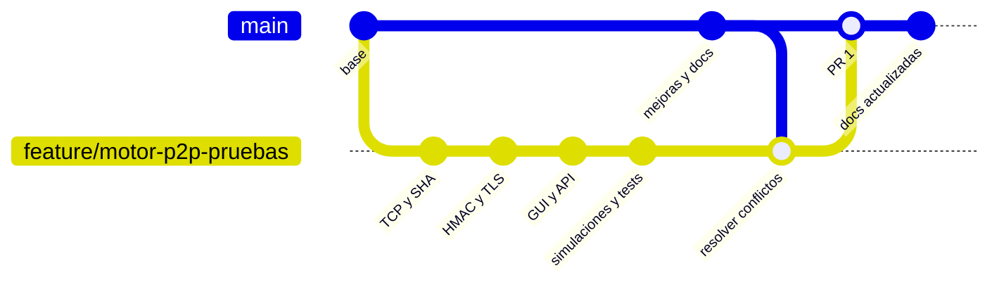

# Control de versiones, historial y procedimiento Git

**Proyecto:** LocalSync LAN Engine · **Repositorio:** [Codeforgeettttt/localsync-lan-engine_SistemasOperativos_G1](https://github.com/Codeforgeettttt/localsync-lan-engine_SistemasOperativos_G1)  
**Última revisión documental:** 18-11-2026.

## 1. Qué se versiona

Hay **dos conceptos diferentes**:

1. **Código fuente:** Git registra cambios, autoría de commits según metadata, ramas, PR, resoluciones de conflictos y revisiones. Un **tag** representaría una versión formal publicada.
2. **Archivos transferidos:** el receptor puede conservar una versión distinta de un archivo como `archivo.conflict-<sha12>.ext`. **Esto no es Git** ni constituye un sistema completo de historial de cambios de usuarios.

La etiqueta interna `0.3.0-lan` aparece en el objeto FastAPI (`src/backend/api/routes.py`). **No equivale por sí misma a un tag Git ni a un release publicado.**

## 2. Historia verificable de integración

| Hito | Evidencia | Qué cambió |
| --- | --- | --- |
| Base inicial del proyecto | Commit `ce7022a` | Estructura, archivos iniciales y documentación de diseño |
| Rama de desarrollo del motor | `feature/motor-p2p-pruebas` | Transporte TCP, integridad, autenticación, GUI y simulaciones |
| Conflictos resueltos | Commit [`b68e528`](https://github.com/Codeforgeettttt/localsync-lan-engine_SistemasOperativos_G1/commit/b68e528f3cf7b0e0d0f99426ed7ddb09b369037a) | Combinó la interfaz nueva con los cambios provenientes de `main` |
| Integración a `main` | [PR #1](https://github.com/Codeforgeettttt/localsync-lan-engine_SistemasOperativos_G1/pull/1) / commit [`2cfc6e6`](https://github.com/Codeforgeettttt/localsync-lan-engine_SistemasOperativos_G1/commit/2cfc6e67583e3c01acce7d71e632d961f7ea5b13) | Fusión del PR, 18-11-2026 |
| Validación del PR integrado | [Windows y Ubuntu](https://github.com/Codeforgeettttt/localsync-lan-engine_SistemasOperativos_G1/actions/runs/44251333149) / [Docker, Chrome y Python](https://github.com/Codeforgeettttt/localsync-lan-engine_SistemasOperativos_G1/actions/runs/44251333232) | CI aprobado en la revisión de integración |
| Consolidación de documentación | Commits `docs(...)` posteriores al merge | README, arquitectura, API, pruebas, manual y control de versiones |

**Importante:** las fechas y commits se toman del historial de GitHub; no se inventan sprints, releases ni una asignación individual de commits que no figure en la metadata del repositorio. Una contribución académica por persona debe respaldarse con commits, PR y evidencias de trabajo, no solo una tabla de responsabilidades.

## 3. Estrategia de ramas



Diagrama conceptual de los hitos comprobados; no representa **cada** commit histórico.

- `main`: rama de integración para un sistema que ya ha pasado pruebas.
- `feature/<alcance>`: código de una mejora o corrección (por ejemplo, `feature/validacion-archivos`).
- `fix/<incidencia>`: rama temporal para defectos.
- `docs/<tema>`: documentación que no debe modificar el comportamiento del motor.
- `test/<caso>`: nuevas pruebas o casos de regresión.

Evitar trabajar en dos ramas con el mismo archivo largo sin sincronizar; eso causó conflictos previamente en `routes.py`, `index.html` y `app.js`.

## 4. Convención de commits

Propuesta alineada con el historial real:

| Prefijo | Uso | Ejemplo |
| --- | --- | --- |
| `feat:` / `feat(modulo):` | Nueva función | `feat(gui): añadir indicador de recepción` |
| `fix:` | Corrección observable | `fix(network): controlar error de timeout` |
| `test:` | Pruebas y aserciones | `test(lan): validar archivos incompletos` |
| `docs:` | README y manuales | `docs(api): actualizar contrato de endpoints` |
| `ci:` | Workflows y automatización | `ci: ejecutar suite en Ubuntu` |
| `refactor:` | Mejorar estructura sin cambiar comportamiento | `refactor(storage): simplificar validación` |
| `chore:` | Mantenimiento menor | `chore: ignorar archivos temporales` |

Mensaje breve, concreto y verificable. Nunca usar commits falsamente atribuidos a otra persona. Para coautoría real puede utilizarse la convención `Co-authored-by`, solo con autorización y participación legítima.

## 5. Procedimiento para desarrollar y proponer un cambio

```bash
# Desde la carpeta del repositorio
git switch main
git pull origin main
git switch -c feature/mi-cambio

# Programar, documentar y probar
python -m pytest -v
git status
git add ruta/del/archivo.py pruebas/test_caso.py
git commit -m "feat(modulo): describir cambio implementado"
git push -u origin feature/mi-cambio
```

Abrir un **pull request** dirigido a `main`. Antes de fusionar, revisar:
- diferencias reales del código y documentación;
- cambios de API, interfaz y pruebas;
- resultados CI en Windows/Ubuntu, Docker y Chrome si corresponde;
- que no haya secretos, bases de datos o archivos personales;
- que el README y los diagramas reflejen el nuevo estado.

Integrar después de aprobación. Si se usa **Squash and merge**, el historial se compacta en un commit; si se usa **Merge commit**, queda el vínculo explícito entre historias.

## 6. Resolver conflictos de manera segura

Cuando GitHub indique conflictos:

```bash
git fetch origin
git switch feature/mi-cambio
git merge origin/main
git status
```

Editar cada archivo indicado, eliminar marcadores `<<<<<<<`, `=======` y `>>>>>>>` **después de revisar ambas versiones**. No elegir "ours" o "theirs" automáticamente si se puede perder funcionalidad.

```bash
git add src/backend/api/routes.py src/frontend/index.html src/frontend/js/app.js
git commit -m "merge(main): resolver conflictos conservando funcionalidad"
python -m pytest -v
git push origin feature/mi-cambio
```

En el caso histórico de LocalSync, se **conservó la GUI nueva** y se incorporaron las pruebas/documentos y validación de destino del `main` anterior, creando un commit de merge con dos padres. El PR fue validado como `mergeable_state: clean` antes de integrarse.

## 7. Versiones y releases: política propuesta

Propuesta para futuros tags (no afirmar que existan actualmente):

- `v0.3.0-lan`: primer tag posible para el prototipo de transferencia manual ya validado.
- `v0.3.1`: correcciones de errores sin cambiar contratos.
- `v0.4.0`: funciones adicionales compatibles.
- `v1.0.0`: reservar para criterios de producto y alcance definidos, pruebas físicas repetibles, documentación y revisión de seguridad suficientes.

Reglas compatibles con Semantic Versioning: **MAJOR** para cambios incompatibles, **MINOR** para nuevas funciones compatibles, **PATCH** para correcciones compatibles. Mientras la API use `0.3.0-lan`, cualquier nombre `v0.3.0-lan` debe etiquetarse solo si se decide publicar formalmente.

Ejemplo de **publicación futura** (no se ejecuta como parte de este documento):

```bash
git switch main
git pull origin main
git tag -a v0.3.0-lan -m "Prototipo de transferencia LAN validado"
git push origin v0.3.0-lan
```

Antes de crear un tag, comprobar si ya existe y registrar su commit exacto; una etiqueta publicada no se debe mover silenciosamente.

## 8. Trazabilidad de entregables

Guardar para cada versión: identificador (tag o commit), fecha, objetivo, cambios, autoría documentada, pruebas, incidencias y documentación afectada. Usar `CHANGELOG.md` y los reportes de GitHub Actions.

```bash
git rev-parse --short HEAD
git log --oneline --graph --decorate --all --max-count=25
git diff --stat origin/main...HEAD
git status --short
```

### Reversión segura

Si un cambio publicado rompe el sistema, **crear un nuevo commit de reversión**, en vez de reescribir `main`:

```bash
git revert <SHA_DEL_COMMIT>
```

En merges se requiere analizar previamente el padre correcto; no ejecutar `git revert -m` sin comprobar el grafo. Evitar `git push --force` en una rama compartida.

## 9. Evidencias disponibles

- [Historial de commits](https://github.com/Codeforgeettttt/localsync-lan-engine_SistemasOperativos_G1/commits/main/)
- [PR y resolución de conflictos](https://github.com/Codeforgeettttt/localsync-lan-engine_SistemasOperativos_G1/pull/1)
- [Workflows CI](https://github.com/Codeforgeettttt/localsync-lan-engine_SistemasOperativos_G1/actions)
- [CHANGELOG del repositorio](../CHANGELOG.md)

**Límite:** Git versiona el proyecto. El sistema no implementa todavía una sincronización distribuida con historial persistente de archivos en SQLite; las copias `.conflict-` son una política local de protección contra sobrescrituras.
