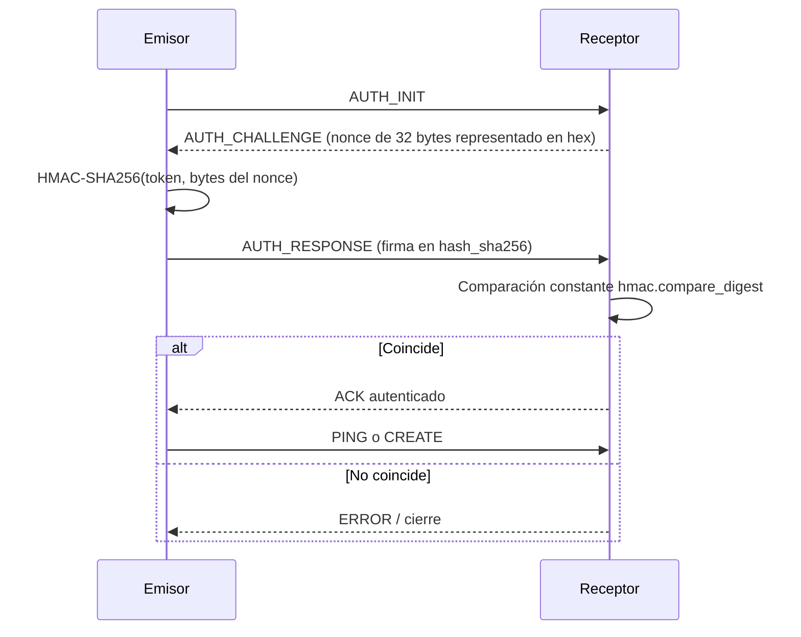
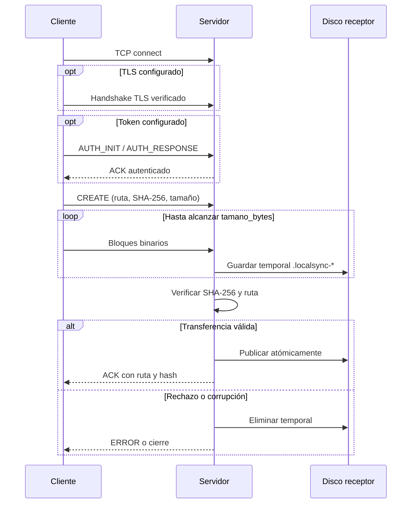

# Especificación técnica del protocolo TCP de LocalSync

**Identificador:** `LOCALSYNC_P2P_V1` · **Implementación:** `src/backend/network/p2p_socket.py` y `cliente_tcp.py` · **Estado:** transferencia manual de archivos.

## 1. Objetivo y alcance

El transporte establece una **conexión TCP por operación**, opcionalmente protegida con TLS, para que un emisor envíe un archivo a un receptor. Antes de aceptar contenido, el receptor verifica autenticación si hay token configurado. Al terminar comprueba SHA-256 y responde `ACK` o `ERROR`.

El protocolo no es SFTP, SMB, FTP ni un estándar externo. Es una implementación académica; evitar redes no confiables hasta completar una auditoría de seguridad.

## 2. Delimitación de la trama

Cada mensaje de control se envía como:

```text
+---------------------------+------------------------------------+
| 4 bytes (uint32 big-endian)| JSON UTF-8                         |
| Longitud = N              | N bytes; N de 1 a 1 048 576       |
+---------------------------+------------------------------------+
```

El límite de **trama JSON es de 1 MiB**; el cuerpo binario **no** está contenido en ese JSON. Para un `CREATE`, inmediatamente después de la cabecera viajan **exactamente `tamano_bytes` bytes** del archivo, en bloques de hasta **64 KiB**.

### Cabecera ejemplo

```json
{
  "protocolo": "LOCALSYNC_P2P_V1",
  "operacion": "CREATE",
  "ruta_relativa": "entregas/documento.txt",
  "hash_sha256": "aaaaaaaaaaaaaaaaaaaaaaaaaaaaaaaaaaaaaaaaaaaaaaaaaaaaaaaaaaaaaaaa",
  "tamano_bytes": 4096
}
```

**Es un ejemplo de estructura, no de un archivo real:** el hash y tamaño deben corresponder al contenido que realmente se envíe.

| Propiedad | Tipo | Regla |
| --- | --- | --- |
| `protocolo` | cadena | Literal `LOCALSYNC_P2P_V1` |
| `operacion` | cadena | `CREATE` para transferencia; `PING`, `ACK` y `ERROR` para control |
| `ruta_relativa` | cadena | Relativa a la carpeta autorizada, sin `..`, ruta absoluta ni enlaces simbólicos |
| `hash_sha256` | cadena | 64 caracteres hexadecimales |
| `tamano_bytes` | entero | En archivos, de 0 a 104 857 600 (100 MiB) |

La capa de serialización también **reconoce** `MODIFY`, `DELETE`, `AUTH_INIT`, `AUTH_CHALLENGE` y `AUTH_RESPONSE`. **Reconocer un nombre de operación no significa implementarlo como acción de sincronización**: el receptor de archivos actualmente atiende `PING` y `CREATE`; `MODIFY` y `DELETE` se rechazan como operaciones no admitidas.

## 3. Autenticación HMAC-SHA256

Cuando `LOCALSYNC_AUTH_TOKEN` está configurada en el receptor:



El token no se envía como texto del protocolo. El emisor y receptor deben conocerlo de antemano. Se requiere longitud mínima **16 caracteres** en el motor; para práctica, usar un secreto aleatorio de **32 bytes o más** (por ejemplo, `openssl rand -hex 32`).

**Este mecanismo demuestra conocimiento del secreto, pero no cifra el archivo.** Para la confidencialidad, activar TLS con certificado válido y verificación del nombre/IP del receptor.

## 4. Flujo de datos



### Respuestas del receptor

- `ACK`: confirmación de `PING`, autenticación o publicación de archivo. Para un archivo incluye `ruta_relativa` definitiva, `tamano_bytes` y `hash_sha256`.
- `ERROR`: problema procesando la solicitud (p. ej., ruta inválida, hash diferente o conflicto rechazado). Si la conexión se corta, el emisor puede recibir una excepción en lugar de una trama.
- `PING`: consulta de salud; el receptor contesta con `ACK` y ruta `pong`.

## 5. Integridad, conflictos e idempotencia

La recepción en `transferencia.py` sigue:

1. Validar la ruta dentro del directorio permitido.
2. Validar longitud y formato SHA-256 anunciado.
3. Crear archivo temporal en el directorio de destino.
4. Leer la cantidad exacta de bytes, calcular SHA-256 incremental.
5. Si el hash no coincide, fallar y eliminar el temporal.
6. Si coincide, aplicar la política de conflicto y publicar mediante `os.replace` bajo bloqueo.

Políticas:

| Política | Resultado ante mismo nombre y contenido distinto |
| --- | --- |
| `keep-both` (predeterminada) | Mantiene archivo original y crea `nombre.conflict-<12hex>.ext` |
| `reject` | Rechaza sin reemplazar el original |
| `overwrite` | Reemplaza de manera explícita el destino existente |

Si el archivo recibido tiene **mismo contenido y hash**, se reutiliza el destino (no se crean duplicados). Si vuelve a enviarse una versión conflictiva idéntica, el sistema evita generar otra copia de esa versión. Esa es la idempotencia demostrada en las pruebas.

**Dos ámbitos diferentes de versionado:** `.conflict-<hash>` conserva contenidos recibidos; Git/commits/tags versiona el **código fuente**.

## 6. Concurrencia, tiempos y recuperación

- Hasta **8 workers concurrentes por defecto** en el servidor, configurables entre 1 y 64.
- Semáforo de admisión limita los clientes pendientes.
- El socket de atención usa `settimeout(15)`. El cliente usa timeouts configurables.
- El cliente puede realizar `--retries N` con espera progresiva ante fallos de red. Los reintentos vuelven a enviar el archivo **desde byte 0** y no conforman un sistema de cola persistente.
- El envío de carpeta recorre archivos normales y conserva la ruta relativa; los enlaces simbólicos no se envían como archivos regulares.

### Fallos controlados

| Evento | Reacción esperada |
| --- | --- |
| Puerto cerrado o IP inaccesible | Error de conexión, posible reintento |
| Token diferente | Autenticación rechazada |
| Trama JSON inválida o demasiado larga | Rechazo; no se publica archivo |
| Ruta absoluta, `..` o symlink | Rechazo por seguridad |
| Tamaño mayor de 100 MiB | Rechazo antes de publicar |
| Cierre prematuro de conexión | Error y limpieza temporal |
| Hash distinto | Rechazo y limpieza del temporal |
| Conflicto con `reject` | Error sin alterar archivo original |
| Mismo contenido ya recibido | Confirmación sin duplicar |

## 7. Seguridad de operación

- Para LAN en modo GUI, el receptor exige un token.
- No exponer `0.0.0.0:9001` a internet; abrir firewall **solo para IP de la otra PC**.
- Para TLS real: `--tls-cert` y `--tls-key` en el receptor; `--tls-ca` en emisor. Ver guía [LAN](../pruebas/GUIA_PRUEBA_LAN.md).
- La implementación no garantiza un canal cifrado **por defecto**. No usarla para información sensible en redes de terceros sin habilitar y verificar TLS.

## 8. Pruebas relacionadas

`pruebas/test_tcp_servidor.py`, `test_cliente_tcp.py`, `test_transferencia.py`, `test_lan_completo.py` y `test_dos_nodos_tcp.py`; además de `simulacion/demo_local.py` y `simulacion/demo.py` para integración.

**No implementado:** negociación de versiones, checksum por fragmento, reanudación parcial, revocación dinámica de credenciales ni `MODIFY` / `DELETE` remotos.
