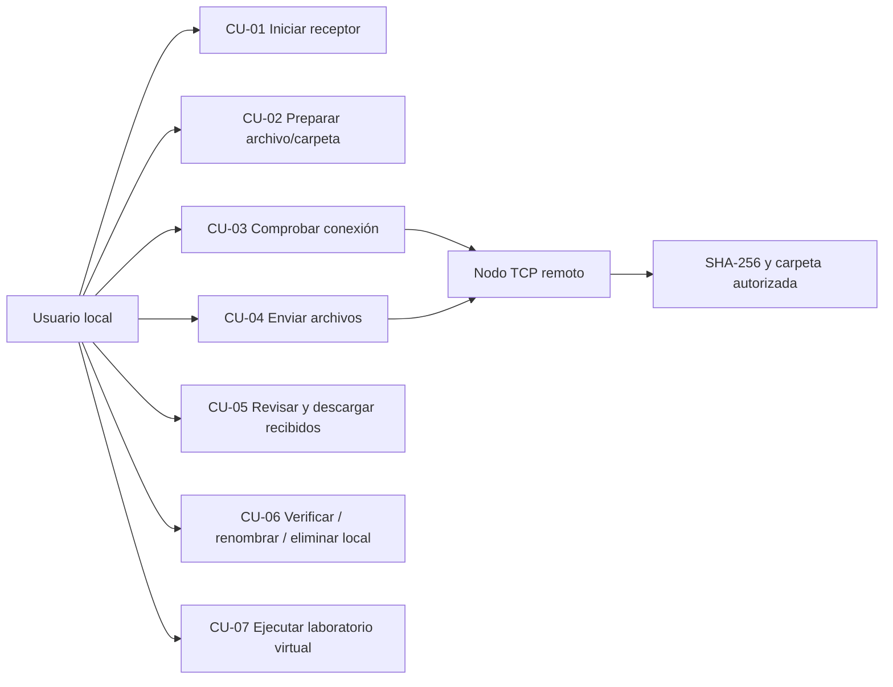

# Requisitos, casos de uso y trazabilidad técnica

**Proyecto:** LocalSync LAN Engine, Grupo G1. **Línea base documental:** código de `main` al 18-11-2026. Esta matriz se ha elaborado contrastando los módulos del repositorio; no pretende transcribir literalmente todos los requisitos contenidos en los PDF históricos.

## 1. Problema y objetivos

**Necesidad:** mover archivos de un computador a otro dentro de una LAN de forma directa, sin subirlos a una plataforma de almacenamiento externa y con verificación de integridad. En el proyecto de Sistemas Operativos interesa demostrar redes TCP, sockets, procesos/threads, manejo de archivos, permisos, seguridad y validación.

**Objetivo general:** implementar y verificar un **sistema de transferencia y sincronización automática de archivos y carpetas** entre equipos en una red local, con una interfaz web local y control de errores.

Objetivos específicos:
1. Establecer conexiones TCP entre nodos del mismo segmento o red local alcanzable.
2. Enviar datos y confirmar recepción mediante ACK.
3. Comprobar integridad usando SHA-256 antes de publicar archivos.
4. Incorporar validación de rutas, autenticación HMAC y TLS configurable.
5. Probar el intercambio de archivos en localhost, contenedores Docker y LAN física.
6. Documentar la arquitectura, operaciones, límites, versiones y evidencias.

## 2. Actores y casos de uso

**Actor principal:** usuario del computador que administra su instancia local de LocalSync. Un computador puede actuar como emisor y receptor. **Actor técnico secundario:** nodo receptor TCP que responde y guarda archivos.

### Caso de uso CU-04: enviar archivo por LAN

- **Precondiciones:** API local iniciada, receptor remoto activo, IP/puerto accesible, token coincidente cuando aplica, archivo en bandeja local.
- **Flujo principal:** elegir archivo → conexión TCP → HMAC opcional → enviar cabecera `CREATE` → transmitir bytes → receptor verifica hash → publica → responde ACK → GUI informa éxito.
- **Alternativas:** conexión rechazada; token inválido; ruta insegura; archivo >100 MiB; hash no coincide; nombre duplicado con otra versión.
- **Postcondición de éxito:** archivo correcto en carpeta autorizada del receptor y SHA-256 coincidente.
- **Postcondición de fallo:** no se reporta éxito falso; un archivo temporal incompleto se limpia en la ruta de recepción.

## 3. Requisitos funcionales trazados

| ID | Requisito | Estado | Código principal | Validación representativa |
| --- | --- | --- | --- | --- |
| RF-01 | Consultar estado del nodo local | Implementado | `api/routes.py`, `lan_routes.py` | `test_panel_lan.py` |
| RF-02 | Configurar receptor TCP en loopback o LAN | Implementado | `lan_routes.py`, `p2p_socket.py` | `test_panel_lan.py` |
| RF-03 | Detectar IPv4 privadas de forma informativa | Implementado | `lan_routes.py` | `test_panel_lan.py` |
| RF-04 | Comprobar conectividad PING/ACK | Implementado | `cliente_tcp.py` | `test_cliente_tcp.py` |
| RF-05 | Preparar archivos y subdirectorios en bandeja | Implementado | `lan_routes.py` | `test_panel_lan.py` |
| RF-06 | Enviar y recibir archivo binario por TCP | Implementado | `cliente_tcp.py`, `p2p_socket.py` | `test_dos_nodos_tcp.py` |
| RF-07 | Enviar carpeta recursiva | Implementado | `cliente_tcp.enviar_carpeta` | `test_lan_completo.py` |
| RF-08 | Verificar SHA-256 y publicar correctamente | Implementado | `transferencia.py` | `test_transferencia.py` |
| RF-09 | Autenticar nodo mediante token HMAC | Implementado | `p2p_socket.py`, `cliente_tcp.py` | `test_lan_completo.py` |
| RF-10 | Configurar TLS opcional | Implementado con configuración explícita | `p2p_socket.py` y cliente | `test_lan_completo.py` |
| RF-11 | Reintentar envío ante fallos de red | Implementado (reenvío total) | `cliente_tcp.py` | Tests de cliente/integración |
| RF-12 | Conservar versiones conflictivas | Implementado | `transferencia.py` | `test_lan_completo.py` |
| RF-13 | Descargar, verificar, renombrar y borrar local | Implementado | `lan_routes.py` + GUI | `test_panel_lan.py` |
| RF-14 | Historial de operaciones de la sesión | Implementado, volátil | `lan_routes._history` | `test_panel_lan.py` |
| RF-15 | Simular dos nodos reales en localhost | Implementado | `simulacion/demo_local.py` | `test_demo_local.py` |
| RF-16 | Simular dos contenedores Linux en LAN privada | Implementado | `simulacion/demo.py` | CI Docker |
| RF-17 | Sincronizar automáticamente tras cambios de archivos | **Implementado** | Watchdog y escaneo `sync/engine.py` | `test_autosync.py` |
| RF-18 | Propagar modificaciones y eliminación remota opt-in | **Implementado con autorización** | `CREATE_RESUME`, `DELETE` autenticado y papelera | `test_sync_bidireccional.py` |
| RF-19 | Cola persistente y recuperación tras desconexiones | **Implementado** | `sync_queue` en SQLite independiente | `test_autosync.py` |
| RF-20 | Reanudar transferencias desde el offset restante | **Implementado** | `CREATE_RESUME` y temporales verificados | `test_resume.py` |

Esta matriz es una clasificación del **software entregado**, no una afirmación de que todos los RF del documento original hayan sido aceptados por el docente.

## 4. Requisitos no funcionales: características y límites

| ID | Propiedad | Implementación y medición | Límite |
| --- | --- | --- | --- |
| RNF-01 | Integridad | SHA-256 en cliente y receptor, comprobado en pruebas | No se implementa firma digital por archivo |
| RNF-02 | Resistencia a errores | Timeouts, ACK, cola persistente y reanudación por offset | No hay limpieza automática de temporales antiguos |
| RNF-03 | Restricción de acceso | HMAC para LAN, panel loopback | TLS no está activado por defecto |
| RNF-04 | Protección de filesystem | Ruta relativa y symlink; carpeta autorizada | No está endurecido contra todas las carreras TOCTOU |
| RNF-05 | Usabilidad | GUI responsive en HTML/CSS/JS, prueba Chrome | No se ha certificado WCAG ni compatibilidad universal |
| RNF-06 | Portabilidad | Pruebas automatizadas Windows y Ubuntu | systemd solo Ubuntu/Linux con gestor compatible |
| RNF-07 | Verificabilidad | unittest/pytest, CI, Docker y navegador | CI no prueba infraestructura física |
| RNF-08 | Límite de archivo | Hasta **100 MiB** por archivo | No hay streaming de tamaño ilimitado |
| RNF-09 | Control de concurrencia | ThreadPoolExecutor y semáforo | No hay benchmark formal de rendimiento |
| RNF-10 | Auditoría | Eventos visibles en sesión | Historial no persistente en SQLite |

**No declarar un SLA**, una capacidad máxima en Mb/s, latencia o porcentaje de éxito sin mediciones reales con metodología replicable.

## 5. Criterios para terminar el proyecto de transferencia manual

- [x] Existe una GUI que controla un motor TCP real.
- [x] El receptor valida autenticación, ruta, tamaño y SHA-256.
- [x] Se puede enviar A → B y B → A, con carpetas y archivos binarios.
- [x] Se manejan conflictos y errores de red.
- [x] Hay pruebas Python, Chrome y simulación Docker en GitHub Actions.
- [ ] Adjuntar acta formal de la transferencia física con capturas y hashes reales.
- [x] Implementadas y verificadas la sincronización automática, cola SQLite, Watchdog y reanudación por offset.
- [ ] Validar físicamente las funciones nuevas de sincronización en los equipos del grupo.

La prueba entre PC físicas fue reportada como exitosa por el equipo. Hasta disponer de evidencia anexada, no se inventan métricas ni resultados de mediciones.

**Referencias internas:** [Arquitectura](ARQUITECTURA.md), [Protocolo](PROTOCOLO_TCP.md), [Plan de pruebas](PRUEBAS_Y_VALIDACION.md), [Seguridad](SEGURIDAD_Y_ERRORES.md), [Modelo de datos](API_Y_DATOS.md).

## 6. Requisitos adicionales implementados

| ID | Requisito | Evidencia |
| --- | --- | --- |
| RF-21 | Descubrir receptores LAN con autenticación UDP/HMAC | `network/discovery.py`; `test_discovery.py` |
| RF-22 | Recuperar versiones antiguas desde la GUI | `sync_versions`; `/api/sync/restaurar` |
| RF-23 | Compartir una carpeta entre dos equipos sin rebote automático | `register_incoming`; `test_sync_bidireccional.py` |
| RF-24 | Arranque automático opcional en Ubuntu | `localsync-autosync.service`; `DESPLIEGUE_FINAL.md` |

**Restricciones restantes:** cambios simultáneos no se resuelven mediante consenso, TLS requiere certificados y no hay cuota/retención automática de respaldos. La prueba física anterior corresponde al transporte manual; la sincronización automática nueva debe desplegarse y verificarse en los dos equipos.
