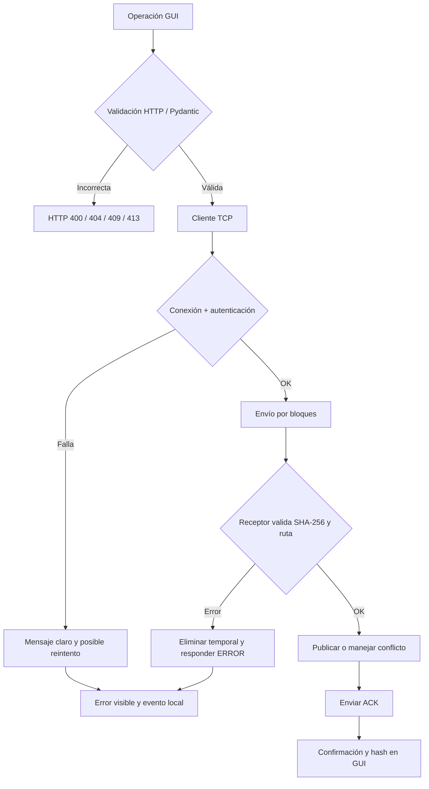

# Seguridad, gestión de errores y límites de operación

**Ámbito:** transferencia TCP en una LAN privada y panel administrativo local.  
**Advertencia:** LocalSync es un proyecto académico y **no cuenta con una auditoría externa de seguridad ni un endurecimiento completo de producción**.

## 1. Suposiciones y modelo de amenazas

Activos a proteger: archivos enviados, carpeta autorizada de recepción, integridad del contenido y control del receptor.

Amenazas consideradas:

- Conexiones no autorizadas desde equipos vecinos de la LAN.
- Modificación accidental del archivo durante transferencia.
- Rutas relativas maliciosas que intenten salir del directorio de recepción.
- Corrupción de datos, cortes de conexión o archivos incompletos.
- Sobrescritura accidental de un archivo diferente con nombre idéntico.
- Errores humanos de IP, puerto, clave, certificados y permisos.
- Exposición indebida del panel de administración HTTP.

Amenazas **no resueltas por completo**: atacante activo con control de la red cuando TLS está apagado, denegación de servicio distribuida, endurecimiento multiusuario del filesystem y administración empresarial de claves.

## 2. Controles de seguridad existentes

### A. Exposición de servicios

- **FastAPI + GUI:** los iniciadores lo escuchan en `127.0.0.1:8080`. Middleware rechaza clientes que no provienen de loopback y valida origen web en acciones mutables.
- **Receptor TCP:** `127.0.0.1:9001` por defecto en CLI; al seleccionar modo LAN escucha `0.0.0.0:9001`. La API LAN exige un token de al menos 16 caracteres.
- **Destinos GUI:** se aceptan direcciones IPv4 privadas y de loopback; se rechazan IP públicas, multicast, dirección no especificada y nombres arbitrarios.
- **Ruta antigua `/api/p2p`:** añade `LOCALSYNC_PAR_LAN` como filtro explícito del destinatario; eso **no reemplaza autenticación del receptor**.

### B. Autenticación y cifrado

- El protocolo utiliza reto aleatorio + **HMAC-SHA256** + comparación `hmac.compare_digest`.
- El secreto **no se transmite** como texto en la conversación HMAC, pero debe intercambiarse previamente por canal privado.
- El motor de sockets admite **TLS opcional**, configurado en receptor mediante `--tls-cert`/`--tls-key` y en emisor mediante `--tls-ca`.
- **HMAC sin TLS no cifra los bytes del archivo**. No enviar información confidencial por Wi-Fi público o una red de terceros sin TLS validado.
- La autenticación de demo Docker usa un secreto efímero; no guardar su valor en README, capturas ni commits.
- No exponer el servicio TCP a Internet ni habilitar reenvío de puertos del router.

### C. Integridad y permisos

- SHA-256 de extremo a extremo: el receptor compara su cálculo con el hash anunciado.
- Se rechazan rutas absolutas, `..`, barras inversas, `NUL` y enlaces simbólicos relevantes en destinos.
- El archivo entra primero a `.localsync-*`; solo al validar tamaño y hash se publica.
- `keep-both` evita sobrescritura silenciosa; `reject` y `overwrite` requieren configuración explícita.
- El receptor limita tamaño a **100 MiB por archivo**, mensajes JSON a **1 MiB** y concurrencia mediante pool de workers.
- Se limpian los temporales cuando ocurre un error durante la recepción.

**Limitación importante:** las comprobaciones de path/symlink no sustituyen la protección completa frente a carreras TOCTOU en un sistema de archivos modificado simultáneamente por usuarios hostiles. Usar carpetas con permisos apropiados en una computadora confiable.

## 3. Diagnóstico de errores de red

| Síntoma | Posible causa | Acción recomendada |
| --- | --- | --- |
| `ConnectionRefusedError` / "Conexión rechazada" | No hay receptor escuchando | Iniciar receptor y verificar puerto, IP y firewall |
| `TimeoutError` / "Tiempo agotado" | Equipo inaccesible, firewall o red aislada | Confirmar misma LAN, `ping`, `ipconfig`/`hostname -I` y regla TCP |
| `Autenticación rechazada` | Tokens distintos, expirados o falta de token | Pegar **el mismo secreto** en ambos extremos, nunca publicarlo |
| `ACK no recibido` | Servidor cerrado, error de recepción o protocolo | Revisar logs del receptor y volver a intentar |
| `Versión incompatible` | Trama distinta a `LOCALSYNC_P2P_V1` | Usar la misma versión del repositorio en ambas máquinas |
| `Longitud de mensaje inválida` | Trama JSON dañada o mayor a 1 MiB | Comprobar implementación del emisor; no continuar |
| `Ruta no autorizada` | Ruta absoluta, traversal o symlink | Escoger ruta relativa dentro de la carpeta autorizada |
| `SHA-256 no coincide` | Bytes incompletos o corruptos | El receptor rechaza; comparar origen/destino y reenviar |
| `Archivo supera 100 MiB` | Límite de tamaño por archivo | Dividir archivo externamente o cambiar alcance tras pruebas |
| `Archivo distinto con mismo nombre` | Política `reject` | Usar `keep-both` o renombrar el archivo |
| Aparece `.conflict-...` | Reenvío de versión con contenido distinto | Revisar y conservar la versión correcta; no es un error de integridad |
| `SSL: CERTIFICATE_VERIFY_FAILED` | Emisor no confía en el certificado o el SAN no coincide | Configurar `--tls-ca` correcto y verificar IP/nombre del certificado |
| `Docker no está disponible` | Docker Desktop apagado o no instalado | Iniciar Docker en modo Linux o utilizar la prueba local sin Docker |
| Panel no abre en `8080` | FastAPI detenido o puerto ocupado | Iniciar con scripts de proyecto y revisar terminal |
| `/api/lan/conexion` responde 200 pero `conectado:false` | Respuesta diagnóstica (no éxito de conexión) | Revisar `detalle`; no asumir conectividad |

**No resolver una falla de conexión exponiendo FastAPI con `--host 0.0.0.0`.** Para transferir entre PCs, únicamente el receptor TCP necesita escuchar en la IP de la LAN.

## 4. Manejo de errores por capa

### Limitaciones del manejo de errores

- El cliente reintenta ante **ciertos errores de conexión**, no ante todos los rechazos semánticos (por ejemplo, ruta inválida o token incorrecto).
- La carpeta se procesa como un **conjunto de envíos individuales**: algunos archivos pueden llegar y otros fallar. La respuesta informa correctos y errores, no es una transacción de carpeta con rollback.
- Con `CREATE_RESUME` los envíos pueden reanudarse desde un temporal persistente; el envío `CREATE` tradicional y los reintentos sin `reanudar` comienzan desde el primer byte.
- El historial de operaciones del panel es **volátil** (`deque` en RAM), no un registro de auditoría persistente ni inmutable.
- La cola persistente SQLite **no** está conectada al transporte.
- `DELETE` sí puede aplicarse al receptor **solo cuando se habilita expresamente y se autentica mediante HMAC**; el archivo se mueve a la papelera interna. Las modificaciones automáticas utilizan `CREATE_RESUME`/`CREATE`, no una operación `MODIFY` independiente.

## 5. Lista de verificación antes de usar en una LAN

- [ ] Ambos equipos en red privada de confianza.
- [ ] Panel web en `127.0.0.1:8080` de cada equipo.
- [ ] IPv4 real del destinatario identificada correctamente.
- [ ] Puerto 9001 permitido **solo desde el otro equipo**.
- [ ] Token largo, privado e idéntico en ambos receptores/emisores.
- [ ] TLS configurado y verificado si los datos son confidenciales.
- [ ] Carpeta de recepción con permisos mínimos necesarios.
- [ ] Se prueban PING/ACK, archivo binario, SHA-256 y reenvío.
- [ ] Se excluyen de capturas y repositorio las claves y los archivos privados.
- [ ] Se cierra el receptor al terminar la prueba.

## 6. Recomendaciones futuras (no implementadas)

Cifrado TLS obligatorio por defecto, certificados gestionados, cuotas globales de almacenamiento para parciales y respaldos, cancelación de envíos, limpieza de fragmentos antiguos, auditoría persistente inmutable, protección avanzada contra carreras de filesystem y consenso para ediciones simultáneas. `CREATE_RESUME`, Watchdog, cola SQLite y réplica entre pares ya existen.

**Relación con el proyecto:** [Protocolo TCP](PROTOCOLO_TCP.md), [arquitectura](ARQUITECTURA.md), [manual](MANUAL_USUARIO.md).

## 7. Seguridad de la sincronización automática (actualización)

### Archivos entrantes y versiones

- La opción **Recibir directamente en carpeta sincronizada** está desactivada por defecto. Cuando se activa, el nodo remoto autorizado puede actualizar el contenido del directorio vigilado.
- Antes de sobrescribir una versión diferente, LocalSync guarda una copia por hash en el directorio de versiones y registra el respaldo en `sync_versions`. Un usuario puede restaurarla desde la GUI.
- Los archivos internos `.localsync_partials` y `.localsync_deleted` se excluyen de la vigilancia y están reservados en la validación de rutas remotas.
- El protocolo `CREATE_RESUME` conserva el temporal cuando la conexión se corta; **no lo publica hasta verificar SHA-256**. Los parciales antiguos consumen espacio: no se purgan automáticamente.
- Los respaldos del motor automático **son locales y persistentes**; no están cifrados en reposo por la aplicación. Asegurar permisos del filesystem y, cuando sea necesario, cifrado de disco.

### Descubrimiento LAN

- El anuncio UDP 9002 exige un desafío HMAC con clave compartida y firma de la respuesta. El token no se envía directamente.
- Encontrar un receptor **no lo añade automáticamente** a la lista de pares. El usuario autoriza la IP desde la GUI.
- Bloquear UDP 9002 impide la búsqueda, **no el TCP manual**: se puede utilizar la IP del receptor.
- No usar el descubrimiento como sustituto de TLS o verificación del origen físico.

### Borrados y protección contra pérdida

- `DELETE` remoto es **opt-in en ambos extremos**. El emisor requiere token y el receptor debe permitir `allow_delete`.
- En lugar de destrucción inmediata, el receptor mueve el archivo a `.localsync_deleted` para recuperación manual. Los borrados repetidos se confirman como operación idempotente.
- La recepción sincronizada puede reemplazar contenido distinto si está activada; conserva la versión anterior antes del reemplazo.
- **No hay consenso distribuido** para conflictos de ediciones simultáneas. La última versión aplicada prevalece, respaldos aparte.

### Control de credenciales

- Los secretos escritos en la GUI permanecen en memoria del proceso. La tabla `sync_peers` persiste IP/puerto pero no el token.
- Para servicio permanente se puede proporcionar el secreto desde `/etc/localsync/autosync.env` con permisos root-only; nunca colocarlo en una variable pública o commit.
- `LOCALSYNC_TLS_CERT`, `LOCALSYNC_TLS_KEY`, `LOCALSYNC_TLS_CA` y `LOCALSYNC_TLS_SERVER_NAME` permiten cifrado cuando se configuran correctamente. HMAC por sí solo **no** cifra.
- El panel HTTP permanece en `127.0.0.1:8080`; al administrar dos computadoras se abren **solo los puertos TCP 9001** y opcionalmente **UDP 9002** al par autorizado.

## 8. Errores adicionales del motor automático

| Situación | Consecuencia | Acción |
| --- | --- | --- |
| Par desconectado | Trabajo queda en `sync_queue` y aumenta `tries` | Revisar IP, receptor y firewall; esperar reintento |
| Reinicio sin token de GUI | Persisten los trabajos, pero no la clave privada del par | Volver a autorizar con token o configurar autostart protegido |
| Cambio de contenido durante envío | Hash anunciado puede dejar de coincidir | Reintentar tras estabilizar el archivo |
| Caída a mitad de `CREATE_RESUME` | Se conserva parcial | Reenviar ruta+SHA idénticos para continuar |
| Parcial corrupto | Se descarta tras verificación fallida | Reintentar desde el inicio |
| Cambio simultáneo A/B | Última versión aplicada y respaldos | Revisar/restaurar versiones; evitar edición simultánea |
| Carpeta compartida no marcada | Los archivos llegan a `archivos_recibidos`, no al espejo | Activar receptor en carpeta compartida |
| Borrado remoto no autorizado | El receptor rechaza `DELETE` | Revisar configuración sin debilitar controles |
| Carpeta interna reservada | Rechazo de ruta | No intentar transferir backups como nombres remotos |
| Volumen de parciales lleno | Error de almacenamiento | Liberar espacio de forma controlada, preservar envíos relevantes |

Para instalar sin exponer credenciales, seguir [DESPLIEGUE_FINAL.md](DESPLIEGUE_FINAL.md).
