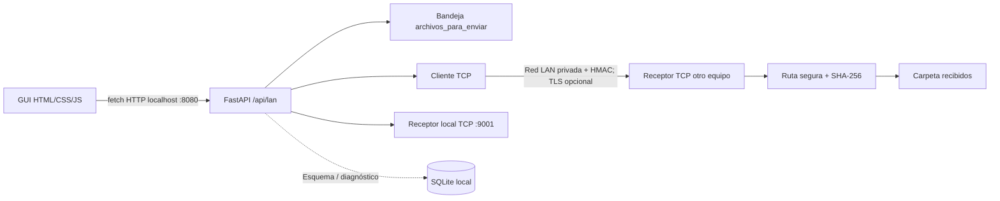

# Integración entre interfaz, API y transporte TCP

**Documento actualizado al código fusionado en `main`, 18-11-2026.**

> Este archivo sustituye la descripción del panel antiguo y de los datos de demostración. La aplicación actual permite **transferencia TCP real manual**. La sincronización automática y la cola persistente aún no están implementadas.

## Componentes y límites



**No confundir:**
- Los eventos del panel se registran **en RAM**.
- Las tablas SQLite existen, pero el envío de archivos **no registra automáticamente** una transacción persistente.
- La API HTTP está confinada a localhost. La conexión de red real viaja por el canal **TCP 9001**, separado.
- La ruta heredada `/api/p2p` tiene restricciones adicionales de destinatario; para la GUI actual se utiliza `/api/lan`.

## Contratos más importantes

| Operación GUI | Endpoint FastAPI | Motor |
| --- | --- | --- |
| Estado/receptor | `GET /api/lan/estado` | `lan_routes.py` |
| Detectar IP | `GET /api/lan/red` | `lan_routes.py` |
| Preparar archivos | `POST /api/lan/archivos` | Upload a bandeja local |
| Comprobar nodo | `POST /api/lan/conexion` | `comprobar_conexion` (PING/ACK) |
| Enviar uno | `POST /api/lan/enviar` | `enviar_archivo` |
| Enviar carpeta | `POST /api/lan/enviar-carpeta` | `enviar_carpeta` |
| Iniciar/detener receptor | `POST /api/lan/receptor/iniciar` / `detener` | `NodoP2PTCP.servir` |
| Verificar/renombrar/eliminar | `GET /api/lan/archivo/verificar` / `PATCH` / `DELETE /api/lan/archivo` | Gestión local |
| Simulación virtual | `POST /api/lan/simulacion/iniciar` | `simulacion/demo.py` |
| Prueba local sin Docker | `POST /api/lan/simulacion/local` | `simulacion/demo_local.py` |
| Guardar evidencia virtual | `GET /api/lan/simulacion/evidencia` | Texto de logs de sesión |

Para campos, validaciones y códigos HTTP: [API_Y_DATOS.md](API_Y_DATOS.md).

## Ejecución actual

En Windows, desde la raíz:

```powershell
.\iniciar_localsync.bat
```

En Ubuntu:

```bash
bash iniciar_localsync.sh
```

El navegador abre `http://127.0.0.1:8080/`. El motor receptor debe iniciarse desde la pestaña **Transferencias**; al seleccionar modo LAN exige token compartido de longitud mínima. Abrir TCP 9001 en firewall para la IP del otro computador (solo en red privada). Para emitir, preparar el archivo desde la GUI, configurar IP/puerto/token del receptor y pulsar **Enviar**.

## Verificación

```bash
python -m pytest -v
python simulacion/demo_local.py
# Requiere Docker Desktop o Docker Engine Linux:
python simulacion/demo.py
```

En los dos computadores reales: registrar ACK, archivo recibido y **hash SHA-256 igual** en ambos. El equipo reportó una prueba física funcional; completar acta de evidencias sin inventar valores: [PRUEBAS_Y_VALIDACION.md](PRUEBAS_Y_VALIDACION.md).

## Alcance y documentación vigente

- El transporte manual, HMAC, integridad y GUI están implementados.
- TLS está disponible **opcionalmente** y requiere certificados para activarse.
- No hay observador Watchdog activo, replicación automática, `MODIFY`/`DELETE` remotos, cola persistente ni reanudación parcial.
- Los diseños PDF y las capturas de fases anteriores se conservan como historial, **no reemplazan el estado actual**.

Diagramas: [ARQUITECTURA.md](ARQUITECTURA.md), [fuentes Mermaid](diagramas/fuentes_mermaid/). Protocolo: [PROTOCOLO_TCP.md](PROTOCOLO_TCP.md). Seguridad: [SEGURIDAD_Y_ERRORES.md](SEGURIDAD_Y_ERRORES.md).
