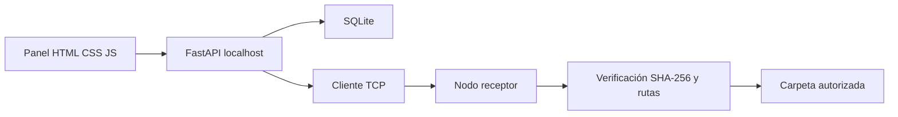

# Integración API, frontend y nodos

## Arquitectura actual



## Contrato REST

| Método | Ruta | Función |
| --- | --- | --- |
| GET | /api/estado | Diagnóstico, componentes y SQLite |
| POST | /api/inicializar-bd | Inicializa esquema |
| POST | /api/control/pausa | Bandera en memoria; no pausa TCP |
| GET | /api/p2p/conexion?host=127.0.0.1&puerto=9001 | PING/ACK |
| POST | /api/p2p/enviar | JSON con nombre, host y puerto |

Swagger: http://127.0.0.1:8080/docs.

## Requisitos y ejecución
Python 3.12 recomendado, dependencias de requirements.txt, terminales y navegador. Ejecutar desde la raíz. En Windows:

```powershell
py -3.12 -m pip install -r requirements.txt
New-Item -ItemType Directory -Force archivos_para_enviar
Set-Content archivos_para_enviar/prueba.txt "LocalSync"
py -3.12 -m unittest discover -s pruebas -p "test_*.py" -v
```

Terminal receptora:
```powershell
py -3.12 -m src.backend.network.p2p_socket --directory recibidos
```

Terminal API:
```powershell
py -3.12 -m uvicorn src.backend.api.routes:app --host 127.0.0.1 --port 8080
```

En Ubuntu, crear entorno virtual con Python 3.12, activarlo, instalar requirements.txt y utilizar python en lugar de py -3.12. Abrir http://127.0.0.1:8080, comprobar conexión y enviar prueba.txt. Verificar contenido y hash. Usar un nombre nuevo si el receptor ya tiene el archivo.

## Prueba LAN pendiente de coordinación

No exponer a Internet ni redes compartidas: el protocolo no tiene TLS ni autenticación. Usar dos equipos o máquinas virtuales en una red aislada. Acordar IP privada del receptor y puerto con Valery. En el receptor iniciar el servidor con --host seguido de su IPv4 privada y --port seguido del puerto acordado. Limitar firewall al equipo emisor. En la terminal de la API definir LOCALSYNC_PAR_LAN con la IP privada acordada antes de iniciar Uvicorn (PowerShell: $env:LOCALSYNC_PAR_LAN = "192.168.1.20"; Linux: export LOCALSYNC_PAR_LAN=192.168.1.20). Sustituir la IP de ejemplo. Conservar API en localhost. Introducir IP y puerto en panel.

## Evidencias para auditoría (pendientes de tomar)
- Panel actualizado y estado SQLite antes/después de inicializar.
- Swagger y respuesta de conexión.
- Envío exitoso, archivo recibido y hashes coincidentes.
- Consola de pruebas automatizadas y prueba con destino no autorizado.
- Prueba entre dos equipos Ubuntu: IP, puerto y resultados de ambos.
- Registrar fecha, versión/commit y resultado real de cada prueba.

## Límites
No declarar sincronización automática, TLS, historial persistente de transferencias ni pruebas LAN aprobadas hasta implementarlas y verificarlas. La autorización de destino mediante variable de entorno no autentica al receptor. Los cambios de esta rama requieren pruebas locales antes de fusionarse.
